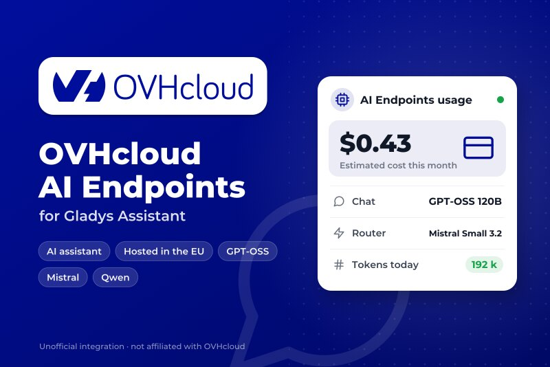
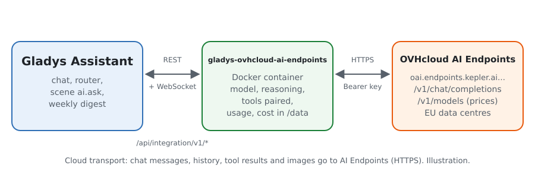
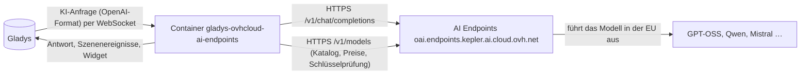
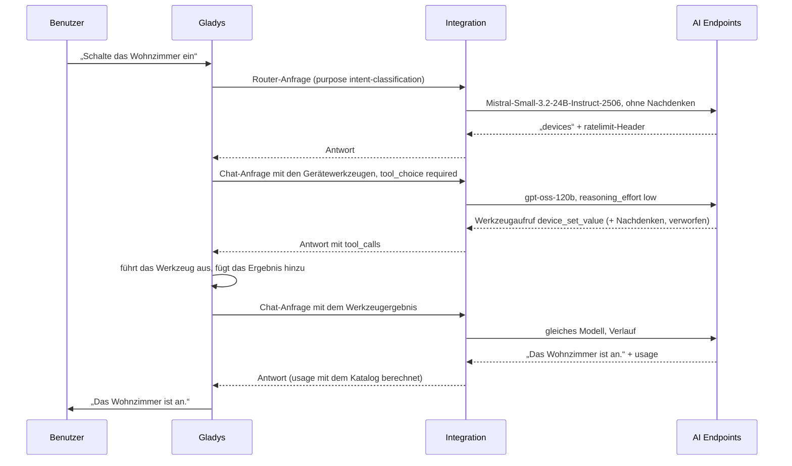
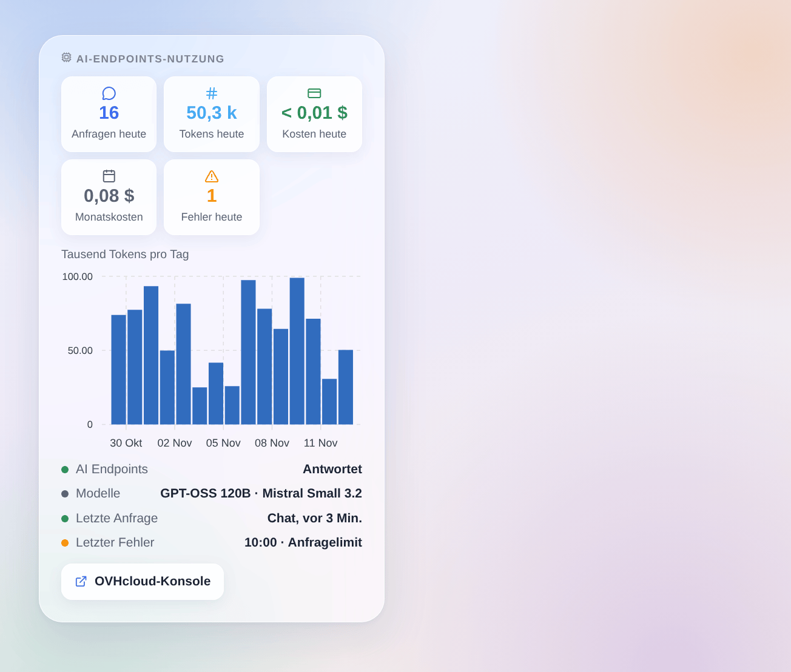

# Gladys OVHcloud AI Endpoints

[English](README.md) · [Français](README.fr.md) · **Deutsch** · [Español](README.es.md)

[](LICENSE)
[](https://github.com/William-De71/gladys-ovhcloud-ai-endpoints/releases)
[](https://github.com/William-De71/gladys-ovhcloud-ai-endpoints/actions/workflows/release.yml)
[](https://gladysassistant.com)



Externe Integration für [Gladys Assistant](https://gladysassistant.com), die den Assistenten von Gladys auf **OVHcloud AI Endpoints** laufen lässt: offene Modelle (OpenAI GPT-OSS, Qwen, Mistral …) aus den Rechenzentren von OVHcloud in der Europäischen Union, pro Token über dein Public-Cloud-Projekt abgerechnet. Sobald sie unter Einstellungen → Künstliche Intelligenz gewählt ist, beantwortet das Modell deiner Wahl den Chat, steuert deine Geräte, erstellt Szenen, beantwortet die Szenenaktion „KI fragen“ und schreibt den Wochenrückblick — mit oder ohne Gladys-Plus-Konto.

Benutzerdokumentation: [English](docs/en.md) · [Français](docs/fr.md) · [Deutsch](docs/de.md) · [Español](docs/es.md).

Nicht mit OVHcloud verbunden. **Noch nicht mit einem echten Schlüssel getestet**: Der Katalog, ein Werkzeugaufruf von GPT-OSS 120B und Mistral Small 3.2, der Parameter für das Nachdenken und die Fehlerantworten (403, 429) wurden am 25. November 2026 von der echten API mitgeschnitten; die Tests laufen gegen eine daraus nachgebildete API. Rückmeldungen sind willkommen.

## Funktionen

- **KI-Anbieter** (`type: "ai"`, Gladys 5.3+): Alle KI-Anfragen von Gladys gehen an AI Endpoints — der Chat mit seinen Werkzeugaufrufen, der Intent-Router, die Szenenaktion „KI fragen“, der Wochenrückblick.
- **Zwei Modelle**: ein Chat-Modell (standardmäßig GPT-OSS 120B) und ein Router-Modell (Mistral Small 3.2, das nicht nachdenkt), aus GPT-OSS 120B und 20B, Qwen 3.5 397B (liest die Chat-Bilder), Mistral Small 3.2, Qwen 3.6 35B oder jeder anderen Modell-ID des Katalogs.
- **Nachdenk-Stufe** des Chat-Modells (aus, niedrig, mittel, hoch), angepasst an das, was jedes Modell akzeptiert.
- **Geschätzte Kosten**: Jede Antwort wird mit den Katalogpreisen berechnet (pro Token, zwischengespeicherte Tokens getrennt), pro Tag und pro Monat.
- **Szenenauslöser**: Der Assistent hat einen Fehler (Schlüssel abgelehnt, Projekt ohne Zahlungsmethode, Anfragelimit, Anfrage zu groß, Modell nicht verfügbar, API nicht erreichbar) und antwortet wieder — einmal pro Ausfall.
- **Dashboard-Widget**: Anfragen, Tokens und geschätzte Kosten des Tages, geschätzte Kosten des Monats, Tokens pro Tag über 30 Tage, letzte Antwort und letzter Fehler.
- Schaltfläche **Verbindung testen**; die Konfigurationsseite zeigt, ob AI Endpoints den Schlüssel akzeptiert und ob beide Modelle Sprachmodelle des Katalogs sind, ohne etwas zu verbrauchen.
- Englisch, Französisch, Deutsch und Spanisch.

## Funktionsweise





Die ganze agentische Schleife (Prompts, Werkzeuge, Verlauf, Bildgröße) bleibt in Gladys; die Integration wählt das Modell und bereitet jede Anfrage und ihre Antwort vor:



Was die Integration übernimmt: Werkzeugaufrufe und Ergebnisse immer gepaart (die IDs, die Gladys für Aufrufe ohne ID schreibt, etwa `unknown`, erhalten stabile; ein einzelner Aufruf erhält ein Platzhalter-Ergebnis), die Nachdenk-Stufe, die dem am nächsten kommt, was jedes Modell akzeptiert (GPT-OSS kann es nicht abschalten, Mistral Small denkt nie nach, ein Modell, das den Parameter ablehnt, bekommt ihn nicht mehr), das Nachdenken, das AI Endpoints in `message.reasoning` zurückgibt, bleibt aus dem Verlauf heraus, und die Grenzen, die Gladys einer Antwort setzt. Ein 429 oder ein 5xx wird wiederholt, solange die Wartezeit des Kerns es erlaubt (18 s für den Router, 110 s für den Chat); eine lange Wartezeit oder eine zu große Anfrage scheitert sofort mit ihrem Grund.

### Transport

`transports: ["cloud"]`: Alles geht per HTTPS an `oai.endpoints.kepler.ai.cloud.ovh.net`. **AI Endpoints sieht jede Chat-Nachricht, den Verlauf, die Werkzeugdefinitionen und -ergebnisse (den Zustand der Geräte, die der Assistent liest) und die Chat-Bilder**, und die Antworten steuern deine Geräte und Szenen. OVHcloud gibt an, dass der Dienst in der Europäischen Union läuft, keine Anfragen speichert und kein Modell damit trainiert. Gladys weicht nie auf Gladys Plus aus, wenn AI Endpoints ausfällt: Der Chat sagt, was nicht stimmt. `/data` hält nur die Zähler des Widgets.

## Modelle

| Wahl              | Modell-ID                             | Einsatz                                                          | Nachdenken    |
| ----------------- | ------------------------------------- | ---------------------------------------------------------------- | ------------- |
| GPT-OSS 120B      | `gpt-oss-120b`                        | Chat (Standard): leistungsfähig, günstig (0,09 $ / 0,47 $ pro M) | niedrig–hoch  |
| Qwen 3.5 397B     | `Qwen3.5-397B-A17B`                   | Chat, der Bilder liest, das größte (0,71 $ / 4,25 $)             | aus–hoch      |
| Mistral Small 3.2 | `Mistral-Small-3.2-24B-Instruct-2506` | Router (Standard) oder schneller Chat (0,10 $ / 0,31 $)          | keins         |
| Qwen 3.6 35B      | `qwen3.6-35b-a3b`                     | Leichter Chat oder Router (0,20 $ / 1,33 $)                      | aus–hoch      |
| GPT-OSS 20B       | `gpt-oss-20b`                         | Leichter Chat oder Router (0,05 $ / 0,18 $)                      | niedrig–hoch  |
| Anderes Modell    | deine ID                              | Jedes Sprachmodell des Katalogs, das Funktionen aufruft          | wie gewünscht |

Preise pro Million Eingabe- / Ausgabe-Tokens, laut Katalog vom 25. November 2026; das Widget liest sie alle 12 Stunden neu. AI Endpoints hat keine „latest“-Aliase: Modelle werden mit drei Monaten Vorlauf eingestellt; „Anderes Modell“ nimmt einen Nachfolger. Der Status meldet, wenn ein gewähltes Modell nicht im Katalog oder kein Sprachmodell ist.

## Szenen und Widget



- **Auslöser „AI Endpoints: Der Assistent hat einen Fehler“**: Variablen `kind` (`auth`, `project`, `rate_limit`, `too_large`, `model`, `unreachable`, `timeout`, `server`), `message`, `use`, `model`; Filter nach Art. Eine abgelehnte Anfrage (HTTP 400, ein Modell, das keine Bilder liest) betrifft nur diese Anfrage und löst nichts aus.
- **Auslöser „AI Endpoints: Der Assistent antwortet wieder“**: Variable `down_minutes`.
- **Widget „AI-Endpoints-Nutzung“**: von der Integration aus der `usage` jeder Antwort und den Katalogpreisen gezählt, in US-Dollar (der Währung des Katalogs); Anfragen außerhalb von Gladys mit demselben Projekt sind nicht enthalten, maßgeblich bleibt die Rechnung des Projekts.
- Keine eigene Szenenaktion: Die Aktion „KI fragen“ von Gladys fragt bereits das hier gewählte Modell, und AI Endpoints hat keine eingebaute Websuche.

Beispiele:

- _Wenn der Assistent einen Fehler hat_ (Art `auth`) → eine Telegram-Nachricht an den Administrator senden: „Der AI-Endpoints-Schlüssel wurde abgelehnt, erstelle einen neuen“.
- _Wenn der Assistent wieder antwortet_ → „Der Assistent ist nach `{{down_minutes}}` Minuten zurück“ senden.
- _Wenn der Assistent einen Fehler hat_ (Art `project`) → eine E-Mail senden: „Füge dem Public-Cloud-Projekt eine Zahlungsmethode hinzu“.

## Voraussetzungen

- Gladys Assistant **5.3.0** oder neuer (KI-Anbieter); ältere Instanzen können die Integration nicht installieren.
- Ein OVHcloud-**Public-Cloud**-Projekt mit einer Zahlungsmethode und ein darin erstellter API-Schlüssel (Control Panel → Public Cloud → AI & Machine Learning → AI Endpoints → API keys).

### Preis und Limits

- **Pro Token**, je nach Modell (siehe Modelle). Eine Chat-Runde macht mindestens zwei Anfragen (Router, dann Chat), mehr, wenn Werkzeuge aufgerufen werden. Der Reiter **Metrics** von AI Endpoints im Control Panel zeigt Aufrufe und Tokens pro Modell.
- **400 Anfragen pro Minute** je Projekt und Modell; ein 429 wird innerhalb der Zeit wiederholt, die der Kern lässt.
- **Ohne Schlüssel**: Die Dokumentation nennt 2 Anfragen pro Minute, aber am 25. November 2026 antwortete die API mit einem Limit von einer Anfrage pro Jahr und Modell (`x-ratelimit-limit-year: 1`): Die Integration ruft nie ohne Schlüssel auf.
- Ein Projekt im **Discovery-Modus** (ohne Zahlungsmethode) wird abgelehnt; der Status sagt es.

## Installation

- **Aus dem Store**: Integrationen → OVHcloud AI Endpoints → Installieren.
- **Über die URL des Repositorys**: Integrationen → externe Integration → `https://github.com/William-De71/gladys-ovhcloud-ai-endpoints`.
- **Entwicklermodus**: `npm start` mit den von Gladys gelieferten Variablen starten (siehe Entwicklung).

## Konfiguration

| Feld oder Schaltfläche     | Standard          | Bedeutung                                                                           |
| -------------------------- | ----------------- | ----------------------------------------------------------------------------------- |
| AI-Endpoints-API-Schlüssel | —                 | Pflichtfeld, ein Geheimnis: nie wieder angezeigt, nie protokolliert                 |
| Chat-Modell                | GPT-OSS 120B      | Chat, Szenenerstellung, Wochenrückblick                                             |
| Router-Modell              | Mistral Small 3.2 | Sortiert jede Nachricht vor der Antwort, innerhalb von 20 s                         |
| ID des anderen Modells     | —                 | Genutzt, wenn ein Modell auf „Anderes Modell“ steht (Groß- und Kleinschreibung)     |
| Nachdenken                 | niedrig           | Des Chat-Modells; der Router bekommt die niedrigste Stufe, die sein Modell kennt    |
| Maximale Antwortlänge      | 8192 Tokens       | Nachdenken inbegriffen; eine Obergrenze, nur geschriebene Tokens werden berechnet   |
| Verbindung testen          | —                 | Eine kurze Antwort jedes Modells, mit seiner Zeit und den übrigen Anfragen (Minute) |

## Verwendung

1. In Gladys (Integrationen → OVHcloud AI Endpoints → Konfiguration): den API-Schlüssel einfügen, die Modelle wählen; **Verbindung testen** drücken.
2. Einstellungen → **Künstliche Intelligenz**: **OVHcloud AI Endpoints** als Anbieter wählen.
3. Im Chat mit Gladys sprechen; das Widget zu einem Dashboard hinzufügen; die Auslöser in deinen Szenen verwenden.

## Entwicklung

```bash
npm install
npm test                       # node --test, eine nachgebildete AI-Endpoints-API auf 127.0.0.1, nie das Netz
npm run lint                   # ESLint
npm run format:check           # Prettier
npx github:GladysAssistant/integration-store . --skip-image-check
scripts/build-cover.sh         # cover.jpg aus docs/assets/cover.svg
docs/illustrations/render.sh   # docs/assets/widgets.<Sprache>.png
```

Lokal liest das SDK `GLADYS_HOST_API_URL`, `GLADYS_INTEGRATION_TOKEN` und `GLADYS_INTEGRATION_SELECTOR` (von Gladys im Entwicklermodus geliefert), und die Integration liest `TZ`. `DEBUG=gladys-integration-sdk` zeigt die Protokolle des SDK.

Die Tests decken den HTTP-Client (Fehler, Limit-Header, Wiederholungen, Fristen), den Katalog und seine Preise, die Umwandlung in beide Richtungen (`validateAiCompletion` des SDK, Paarung), den Chat-Handler (Modell je Zweck, Nachdenken, abgelehnter Parameter, Kosten), die Auslöser, die Zähler, das Widget (`validateWidgetContent`), das Manifest, die vier Sprachen, das Release-Skript und die ganze Integration gegen das nachgebildete Gladys des SDK ab. `test/structure.test.js` friert jeden Schlüssel ein, den Benutzer speichern.

## Release-Prozess


Jeder Merge auf `main` startet die CI und berechnet dann die Version aus den [Conventional Commits](https://www.conventionalcommits.org/de/) seit dem letzten Tag: `feat` → Minor, `fix` / `perf` → Patch, `!` oder `BREAKING CHANGE` → Major (ein Minor unter 1.0.0); `docs`, `chore`, `ci`, `test`, `style`, `refactor`, `build` allein veröffentlichen nichts. Der Changelog-Abschnitt wird erzeugt, der Tag gepusht, das Multi-Architektur-Image gebaut, dann erhält `main` den Release-Commit, das GitHub Release wird erstellt und ein letzter Job prüft das öffentliche Image, den Store-Validator und das Topic.

- Der Titel des Pull Requests wird zum Squash-Commit und dann zur Changelog-Zeile: auf Englisch, für den Benutzer schreiben (`pr-title.yml` prüft ihn). `CHANGELOG.md` nie von Hand bearbeiten.
- 1.0.0 ist eine Entscheidung: Actions → Release → Run workflow mit `release-as: 1.0.0`. `dry-run` zeigt Version und Notizen, ohne zu veröffentlichen.
- **Geschützter Branch**: Rulesets verlangen einen Pull Request auf `main` und sperren die `v*`-Tags; nur der Maintainer und Deploy Keys kommen durch. Das Release pusht mit dem Deploy Key der Umgebung `release` (Secret `RELEASE_DEPLOY_KEY`, nur `main`): Ein Lauf von einem anderen Branch erhält ihn nie. `build.yml` und `github-release.yml` starten nicht bei einem Tag: Das Release ruft sie auf, oder starten Sie sie von Hand (Actions → Run workflow, mit `version` für das Image), um ein Release abzuschließen.
- Nach dem ersten Release das `ghcr.io`-Paket öffentlich machen (Package settings → Change visibility), sonst kann Gladys es nicht laden.

## Fehlerbehebung

Siehe [docs/de.md](docs/de.md#fehlerbehebung). Melde Probleme mit den Versionen von Gladys und der Integration, den gewählten Modellen und der Meldung von **Verbindung testen**. Füge nie deinen API-Schlüssel ein.

## Mitwirken

Issues und Pull Requests sind willkommen, besonders von Leuten mit einem AI-Endpoints-Schlüssel: Eine fehlschlagende Anfrage (ohne den Schlüssel) hilft sehr. Führe vor einem Pull Request `npm run format:check && npm run lint && npm test` aus und lass jeden gespeicherten Schlüssel unverändert (siehe [CLAUDE.md](CLAUDE.md)).

## Sicherheit

Siehe [SECURITY.md](SECURITY.md): Sicherheitslücken bitte vertraulich melden. Der API-Schlüssel ist ein `secret`-Feld: nie protokolliert, nie in `/data` geschrieben, nur per HTTPS an `oai.endpoints.kepler.ai.cloud.ovh.net` gesendet.

## Kommende Screenshots

Die Bilder oben sind Illustrationen, keine Screenshots. Echte Screenshots kommen nach `docs/assets/screenshots/` (PNG, 1280 × 800): `configuration.png` (die Konfiguration mit ihrem Status), `ai-settings.png` (OVHcloud AI Endpoints unter Einstellungen → Künstliche Intelligenz gewählt), `chat.png` (ein Chat, der ein Gerät einschaltet), `widget.png` (das Nutzungs-Widget auf einem Dashboard).

## Lizenz

[Apache License 2.0](LICENSE) — siehe auch [NOTICE](NOTICE). OVHcloud ist eine Marke der OVH SAS; Modellnamen gehören ihren Inhabern. Dieses Projekt ist nicht mit OVHcloud verbunden, nicht von OVHcloud unterstützt oder gesponsert. Danke an die Dokumentation und das SDK von Gladys sowie an die Dokumentation von OVHcloud.
