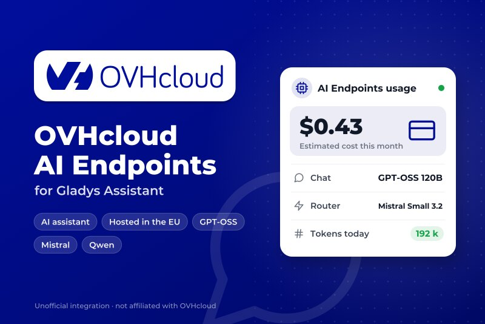
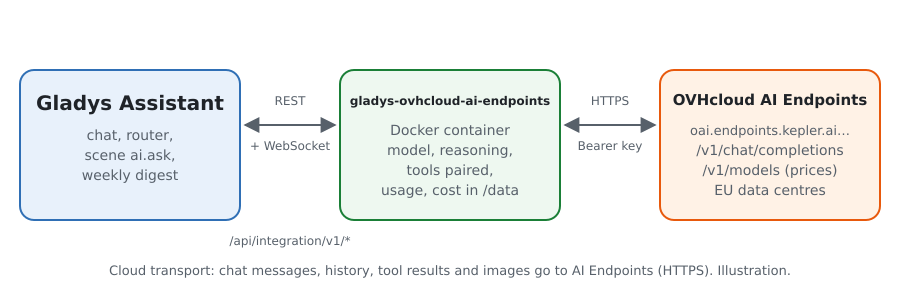
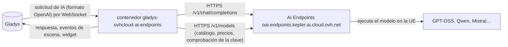
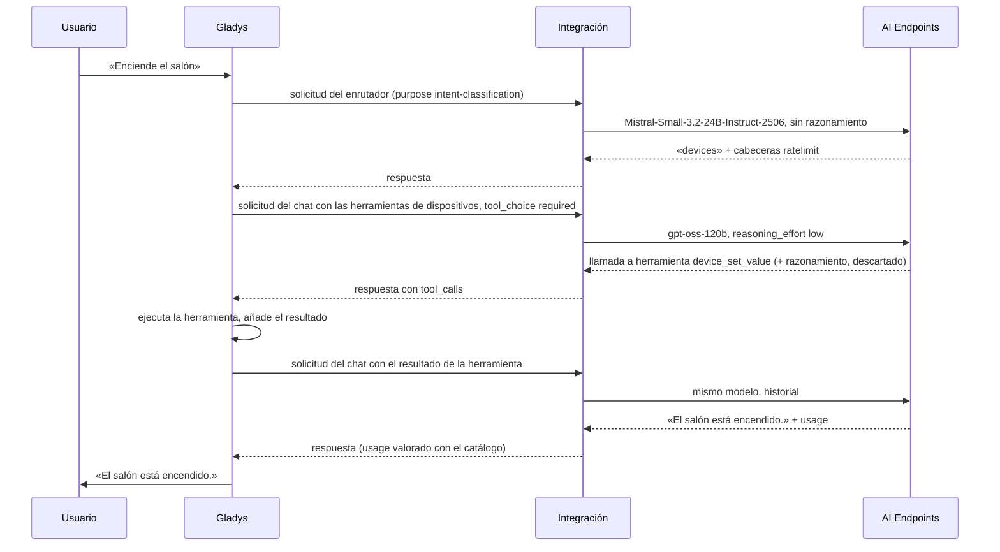
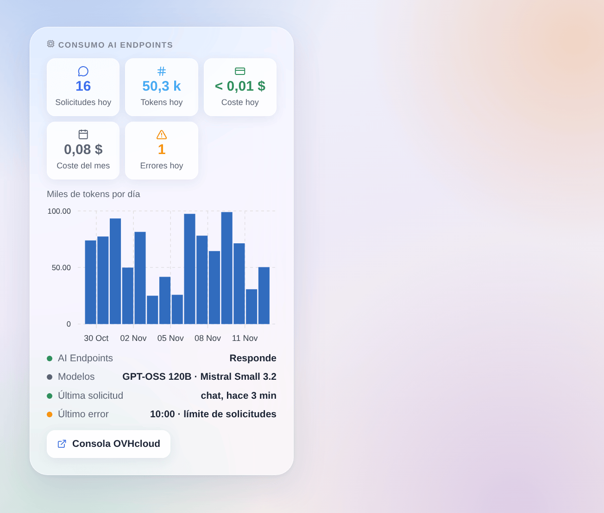

# Gladys OVHcloud AI Endpoints

[English](README.md) · [Français](README.fr.md) · [Deutsch](README.de.md) · **Español**

[](LICENSE)
[](https://github.com/William-De71/gladys-ovhcloud-ai-endpoints/releases)
[](https://github.com/William-De71/gladys-ovhcloud-ai-endpoints/actions/workflows/release.yml)
[](https://gladysassistant.com)



Integración externa de [Gladys Assistant](https://gladysassistant.com) que ejecuta el asistente de Gladys en **OVHcloud AI Endpoints**: modelos abiertos (OpenAI GPT-OSS, Qwen, Mistral…) servidos desde los centros de datos de OVHcloud en la Unión Europea, facturados por token a su proyecto Public Cloud. Una vez elegida en Ajustes → Inteligencia artificial, el modelo que elija responde al chat, controla sus dispositivos, crea escenas, responde a la acción de escena «preguntar a la IA» y redacta el resumen semanal — con o sin cuenta Gladys Plus.

Documentación de usuario: [English](docs/en.md) · [Français](docs/fr.md) · [Deutsch](docs/de.md) · [Español](docs/es.md).

Sin relación con OVHcloud. **Todavía no probada con una clave real**: el catálogo, una llamada a herramienta de GPT-OSS 120B y de Mistral Small 3.2, el parámetro de razonamiento y las respuestas de error (403, 429) se capturaron de la API real el 25 de noviembre de 2026; las pruebas se ejecutan contra una API simulada construida a partir de ellos. Se agradecen los comentarios.

## Funciones

- **Proveedor de IA** (`type: "ai"`, Gladys 5.3+): todas las solicitudes de IA de Gladys van a AI Endpoints — el chat con sus llamadas a herramientas, el enrutador de intenciones, la acción de escena «preguntar a la IA», el resumen semanal.
- **Dos modelos**: un modelo de chat (GPT-OSS 120B por defecto) y un modelo de enrutador (Mistral Small 3.2, que no razona), entre GPT-OSS 120B y 20B, Qwen 3.5 397B (lee las imágenes del chat), Mistral Small 3.2, Qwen 3.6 35B o cualquier otro identificador del catálogo.
- **Nivel de razonamiento** del modelo del chat (desactivado, bajo, medio, alto), adaptado a lo que acepta cada modelo.
- **Coste estimado**: cada respuesta se valora con los precios del catálogo (por token, tokens en caché aparte), por día y por mes.
- **Disparadores de escena**: el asistente falla (clave rechazada, proyecto sin método de pago, límite de solicitudes, solicitud demasiado grande, modelo no disponible, API inaccesible) y vuelve a responder — una vez por fallo.
- **Widget del panel**: solicitudes, tokens y coste estimado del día, coste estimado del mes, tokens por día en 30 días, última respuesta y último error.
- Botón **Probar la conexión**; la pantalla de configuración indica si AI Endpoints acepta la clave y si los dos modelos son modelos de lenguaje del catálogo, sin gastar nada.
- Inglés, francés, alemán y español.

## Funcionamiento





Todo el bucle agéntico (prompts, herramientas, historial, redimensionado de imágenes) se queda en Gladys; la integración elige el modelo y prepara cada solicitud y su respuesta:



Lo que gestiona la integración: llamadas a herramientas y resultados siempre emparejados (los identificadores que Gladys escribe para llamadas sin identificador, como `unknown`, reciben uno estable; una llamada sola recibe un resultado de reserva), el nivel de razonamiento más cercano a lo que acepta cada modelo (GPT-OSS no puede desactivarlo, Mistral Small nunca razona, un modelo que rechaza el parámetro deja de recibirlo), el razonamiento que AI Endpoints devuelve en `message.reasoning` queda fuera del historial, y los límites que Gladys impone a una respuesta. Un 429 o un 5xx se reintenta mientras el tiempo de espera del núcleo lo permita (18 s para el enrutador, 110 s para el chat); una espera larga o una solicitud demasiado grande falla al momento con su motivo.

### Transporte

`transports: ["cloud"]`: todo va a `oai.endpoints.kepler.ai.cloud.ovh.net` por HTTPS. **AI Endpoints ve cada mensaje del chat, el historial, las definiciones y resultados de las herramientas (el estado de los dispositivos que lee el asistente) y las imágenes del chat**, y las respuestas controlan sus dispositivos y escenas. OVHcloud afirma que el servicio funciona en la Unión Europea, no conserva ninguna solicitud ni entrena ningún modelo con ellas. Gladys nunca recurre a Gladys Plus cuando AI Endpoints falla: el chat dice qué pasa. `/data` solo guarda los contadores del widget.

## Modelos

| Opción            | Identificador                         | Uso                                                           | Razonamiento       |
| ----------------- | ------------------------------------- | ------------------------------------------------------------- | ------------------ |
| GPT-OSS 120B      | `gpt-oss-120b`                        | Chat (por defecto): capaz, económico (0,09 $ / 0,47 $ por M)  | bajo a alto        |
| Qwen 3.5 397B     | `Qwen3.5-397B-A17B`                   | Chat que lee imágenes, el mayor (0,71 $ / 4,25 $)             | desactivado a alto |
| Mistral Small 3.2 | `Mistral-Small-3.2-24B-Instruct-2506` | Enrutador (por defecto) o chat rápido (0,10 $ / 0,31 $)       | ninguno            |
| Qwen 3.6 35B      | `qwen3.6-35b-a3b`                     | Chat ligero o enrutador (0,20 $ / 1,33 $)                     | desactivado a alto |
| GPT-OSS 20B       | `gpt-oss-20b`                         | Chat ligero o enrutador (0,05 $ / 0,18 $)                     | bajo a alto        |
| Otro modelo       | su identificador                      | Cualquier modelo de lenguaje del catálogo que llame funciones | según lo pedido    |

Precios por millón de tokens de entrada / salida, según el catálogo del 25 de noviembre de 2026; el widget los vuelve a leer cada 12 horas. AI Endpoints no tiene alias «latest»: retira los modelos con tres meses de aviso; «Otro modelo» admite un sucesor. El estado avisa cuando un modelo elegido no está en el catálogo o no es un modelo de lenguaje.

## Escenas y widget



- **Disparador «AI Endpoints: el asistente falla»**: variables `kind` (`auth`, `project`, `rate_limit`, `too_large`, `model`, `unreachable`, `timeout`, `server`), `message`, `use`, `model`; filtro por tipo. Una solicitud rechazada (HTTP 400, un modelo que no lee imágenes) solo afecta a esa solicitud y no dispara nada.
- **Disparador «AI Endpoints: el asistente vuelve a responder»**: variable `down_minutes`.
- **Widget «Consumo AI Endpoints»**: contado por la integración a partir del `usage` de cada respuesta y de los precios del catálogo, en dólares estadounidenses (la moneda del catálogo); no incluye las solicitudes hechas fuera de Gladys con el mismo proyecto, y la factura del proyecto sigue siendo la referencia.
- Sin acción de escena propia: la acción «preguntar a la IA» de Gladys ya consulta el modelo elegido aquí, y AI Endpoints no tiene búsqueda web integrada.

Ejemplos:

- _Cuando el asistente falla_ (tipo `auth`) → enviar un mensaje de Telegram al administrador: «la clave de AI Endpoints se ha rechazado, cree una nueva».
- _Cuando el asistente vuelve a responder_ → enviar «el asistente ha vuelto tras `{{down_minutes}}` minutos».
- _Cuando el asistente falla_ (tipo `project`) → enviar un correo: «añada un método de pago al proyecto Public Cloud».

## Requisitos

- Gladys Assistant **5.3.0** o posterior (proveedores de IA); las instancias más antiguas no pueden instalar la integración.
- Un proyecto **Public Cloud** de OVHcloud con un método de pago y una clave de API creada en él (área de cliente → Public Cloud → AI & Machine Learning → AI Endpoints → API keys).

### Precio y límites

- **Por token**, según el modelo (vea Modelos). Un turno de chat hace al menos dos solicitudes (enrutador y luego chat), más cuando se llaman herramientas. La pestaña **Metrics** de AI Endpoints en el área de cliente muestra las llamadas y los tokens por modelo.
- **400 solicitudes por minuto**, por proyecto y por modelo; un 429 se reintenta dentro del tiempo que deja el núcleo.
- **Sin clave**: la documentación indica 2 solicitudes por minuto, pero el 25 de noviembre de 2026 la API respondió con un límite de una solicitud al año por modelo (`x-ratelimit-limit-year: 1`): la integración nunca llama sin clave.
- Un proyecto en **modo Discovery** (sin método de pago) se rechaza; el estado lo indica.

## Instalación

- **Desde la tienda**: Integraciones → OVHcloud AI Endpoints → Instalar.
- **Desde la URL del repositorio**: Integraciones → integración externa → `https://github.com/William-De71/gladys-ovhcloud-ai-endpoints`.
- **Modo desarrollador**: ejecute `npm start` con las variables que da Gladys (vea Desarrollo).

## Configuración

| Campo o botón                    | Por defecto       | Significado                                                                             |
| -------------------------------- | ----------------- | --------------------------------------------------------------------------------------- |
| Clave de API de AI Endpoints     | —                 | Obligatoria, un secreto: nunca se vuelve a mostrar ni se registra                       |
| Modelo del chat                  | GPT-OSS 120B      | Chat, creación de escenas, resumen semanal                                              |
| Modelo del enrutador             | Mistral Small 3.2 | Clasifica cada mensaje antes de la respuesta, en menos de 20 s                          |
| Identificador del otro modelo    | —                 | Se usa cuando un modelo está en «Otro modelo» (mayúsculas y minúsculas)                 |
| Razonamiento                     | bajo              | Del modelo del chat; el enrutador recibe el nivel más bajo que acepta su modelo         |
| Longitud máxima de una respuesta | 8192 tokens       | Razonamiento incluido; un límite, solo se facturan los tokens escritos                  |
| Probar la conexión               | —                 | Una respuesta corta de cada modelo, con su tiempo y las solicitudes que quedan (minuto) |

## Uso

1. En Gladys (Integraciones → OVHcloud AI Endpoints → Configuración): pegue la clave de API, elija los modelos; pulse **Probar la conexión**.
2. Ajustes → **Inteligencia artificial**: elija **OVHcloud AI Endpoints** como proveedor.
3. Hable con Gladys en el chat; añada el widget a un panel; use los disparadores en sus escenas.

## Desarrollo

```bash
npm install
npm test                       # node --test, una API de AI Endpoints simulada en 127.0.0.1, nunca la red
npm run lint                   # ESLint
npm run format:check           # Prettier
npx github:GladysAssistant/integration-store . --skip-image-check
scripts/build-cover.sh         # cover.jpg a partir de docs/assets/cover.svg
docs/illustrations/render.sh   # docs/assets/widgets.<idioma>.png
```

En local, el SDK lee `GLADYS_HOST_API_URL`, `GLADYS_INTEGRATION_TOKEN` y `GLADYS_INTEGRATION_SELECTOR` (que Gladys da en modo desarrollador), y la integración lee `TZ`. `DEBUG=gladys-integration-sdk` muestra los registros del SDK.

Las pruebas cubren el cliente HTTP (errores, cabeceras de límites, reintentos, plazos), el catálogo y sus precios, la conversión en ambos sentidos (`validateAiCompletion` del SDK, emparejamiento), el gestor del chat (modelo por uso, razonamiento, parámetro rechazado, coste), los disparadores, los contadores, el widget (`validateWidgetContent`), el manifiesto, los cuatro idiomas, el script de publicación y toda la integración contra el Gladys simulado del SDK. `test/structure.test.js` congela cada clave que guardan los usuarios.

## Proceso de publicación


Cada fusión en `main` ejecuta la CI y luego calcula la versión a partir de los [Conventional Commits](https://www.conventionalcommits.org/es/) desde la última etiqueta: `feat` → menor, `fix` / `perf` → parche, `!` o `BREAKING CHANGE` → mayor (una menor por debajo de 1.0.0); `docs`, `chore`, `ci`, `test`, `style`, `refactor`, `build` solos no publican nada. Se genera la sección del changelog, se sube la etiqueta, se construye la imagen multiarquitectura, luego `main` recibe el commit de publicación, se crea la GitHub Release y un último job comprueba la imagen pública, el validador de la tienda y el topic.

- El título de la pull request se convierte en el commit squash y luego en la línea del changelog: escríbalo en inglés, para el usuario (`pr-title.yml` lo comprueba). No edite nunca `CHANGELOG.md` a mano.
- La 1.0.0 es una decisión: Actions → Release → Run workflow con `release-as: 1.0.0`. `dry-run` muestra la versión y las notas sin publicar.
- **Rama protegida**: unos rulesets exigen una pull request en `main` y bloquean las etiquetas `v*`; solo pasan el mantenedor y las deploy keys. La publicación hace push con la deploy key del entorno `release` (secreto `RELEASE_DEPLOY_KEY`, solo `main`): una ejecución lanzada desde otra rama nunca la obtiene. `build.yml` y `github-release.yml` no arrancan con una etiqueta: la publicación los llama, o lánzelos a mano (Actions → Run workflow, con `version` para la imagen) para terminar una publicación.
- Tras la primera publicación, haga público el paquete de `ghcr.io` (Package settings → Change visibility), o Gladys no podrá descargarlo.

## Solución de problemas

Vea [docs/es.md](docs/es.md#solución-de-problemas). Informe de los problemas con las versiones de Gladys y de la integración, los modelos elegidos y el mensaje de **Probar la conexión**. No pegue nunca su clave de API.

## Contribuir

Las issues y pull requests son bienvenidas, sobre todo de personas con una clave de AI Endpoints: una solicitud que falla (sin la clave) ayuda mucho. Ejecute `npm run format:check && npm run lint && npm test` antes de abrir una pull request y mantenga sin cambios cada clave guardada (vea [CLAUDE.md](CLAUDE.md)).

## Seguridad

Vea [SECURITY.md](SECURITY.md): informe de las vulnerabilidades en privado. La clave de API es un campo `secret`: nunca se registra, nunca se escribe en `/data` y solo se envía a `oai.endpoints.kepler.ai.cloud.ovh.net` por HTTPS.

## Capturas pendientes

Las imágenes de arriba son ilustraciones, no capturas. Las capturas reales irán en `docs/assets/screenshots/` (PNG, 1280 × 800): `configuration.png` (la configuración con su estado), `ai-settings.png` (OVHcloud AI Endpoints elegido en Ajustes → Inteligencia artificial), `chat.png` (un chat que enciende un dispositivo), `widget.png` (el widget de consumo en un panel).

## Licencia

[Licencia Apache 2.0](LICENSE) — vea también [NOTICE](NOTICE). OVHcloud es una marca de OVH SAS; los nombres de los modelos pertenecen a sus propietarios. Este proyecto no está afiliado, respaldado ni patrocinado por OVHcloud. Gracias a la documentación y al SDK de Gladys, y a la documentación de OVHcloud.
