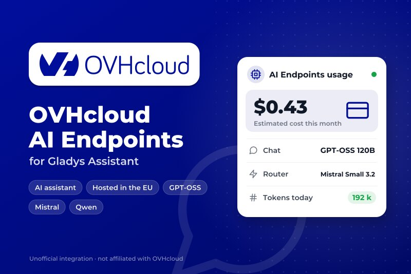
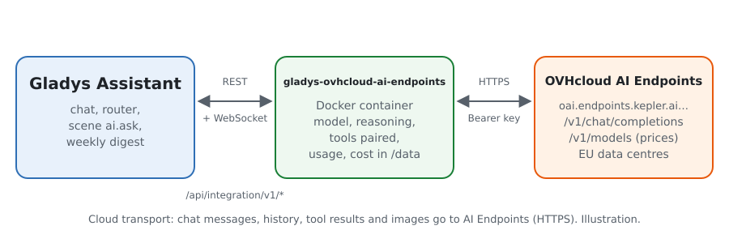
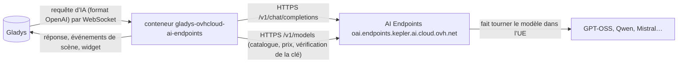
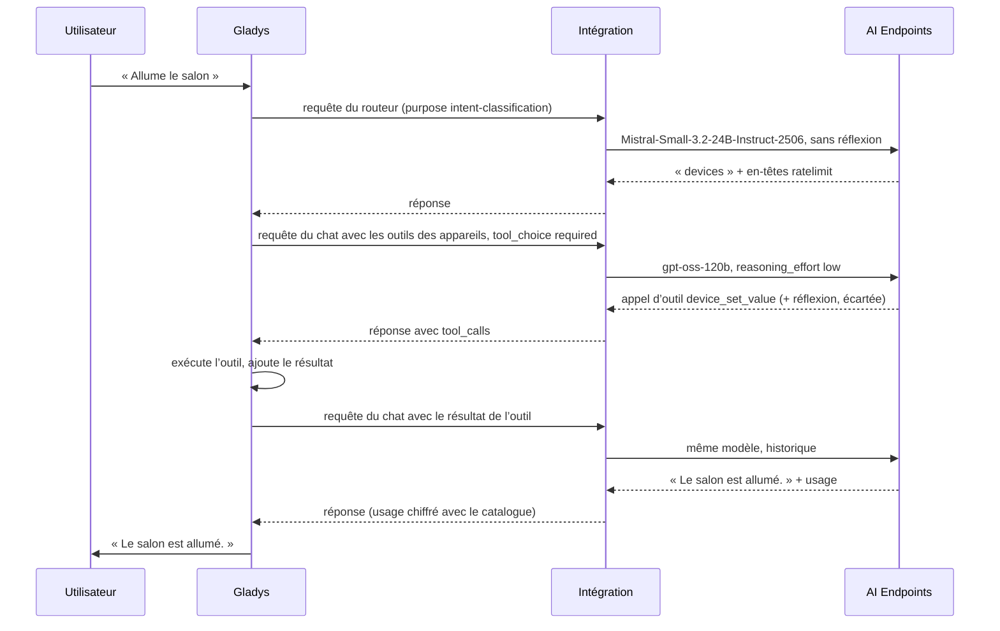
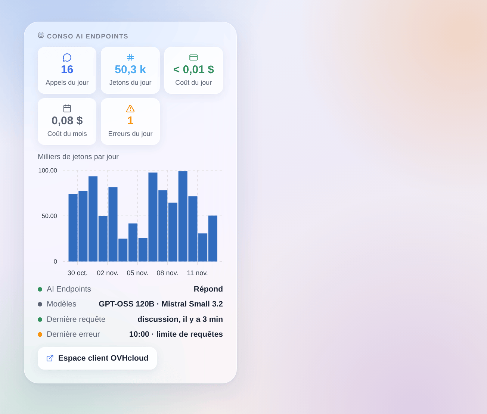

# Gladys OVHcloud AI Endpoints

[English](README.md) · **Français** · [Deutsch](README.de.md) · [Español](README.es.md)

[](LICENSE)
[](https://github.com/William-De71/gladys-ovhcloud-ai-endpoints/releases)
[](https://github.com/William-De71/gladys-ovhcloud-ai-endpoints/actions/workflows/release.yml)
[](https://gladysassistant.com)



Intégration externe de [Gladys Assistant](https://gladysassistant.com) qui fait tourner l’assistant de Gladys sur **OVHcloud AI Endpoints** : des modèles ouverts (OpenAI GPT-OSS, Qwen, Mistral…) servis depuis les centres de données d’OVHcloud dans l’Union européenne, facturés au jeton sur votre projet Public Cloud. Une fois choisie dans Paramètres → Intelligence artificielle, le modèle de votre choix répond au chat, pilote vos appareils, crée des scènes, répond à l’action de scène « demander à l’IA » et rédige le résumé hebdomadaire — avec ou sans compte Gladys Plus.

Documentation utilisateur : [English](docs/en.md) · [Français](docs/fr.md) · [Deutsch](docs/de.md) · [Español](docs/es.md).

Sans lien avec OVHcloud. **Pas encore testée avec une vraie clé** : le catalogue, un appel d’outil de GPT-OSS 120B et de Mistral Small 3.2, le paramètre de réflexion et les réponses d’erreur (403, 429) ont été capturés sur la vraie API le 25 novembre 2026 ; les tests tournent contre une fausse API construite à partir d’eux. Les retours sont bienvenus.

## Fonctionnalités

- **Fournisseur d’IA** (`type: "ai"`, Gladys 5.3+) : toutes les requêtes d’IA de Gladys partent vers AI Endpoints — le chat et ses appels d’outils, le routeur d’intentions, l’action de scène « demander à l’IA », le résumé hebdomadaire.
- **Deux modèles** : un modèle de chat (GPT-OSS 120B par défaut) et un modèle de routeur (Mistral Small 3.2, qui ne réfléchit pas), parmi GPT-OSS 120B et 20B, Qwen 3.5 397B (lit les images du chat), Mistral Small 3.2, Qwen 3.6 35B ou tout autre identifiant du catalogue.
- **Niveau de réflexion** du modèle du chat (désactivée, faible, moyenne, élevée), adapté à ce que chaque modèle accepte.
- **Coût estimé** : chaque réponse est chiffrée avec les prix du catalogue (au jeton, jetons en cache à part), par jour et par mois.
- **Déclencheurs de scène** : l’assistant est en erreur (clé refusée, projet sans moyen de paiement, limite de requêtes, requête trop grosse, modèle indisponible, API injoignable) et répond de nouveau — une fois par panne.
- **Widget de tableau de bord** : requêtes, jetons et coût estimé du jour, coût estimé du mois, jetons par jour sur 30 jours, dernière réponse et dernière erreur.
- Bouton **Tester la connexion** ; l’écran de configuration indique si AI Endpoints accepte la clé et si les deux modèles sont des modèles de langage du catalogue, sans rien dépenser.
- Anglais, français, allemand et espagnol.

## Fonctionnement





Toute la boucle agentique (prompts, outils, historique, redimensionnement des images) reste dans Gladys ; l’intégration choisit le modèle et prépare chaque requête et sa réponse :



Ce que l’intégration prend en charge : appels d’outils et résultats toujours appariés (les identifiants que Gladys écrit pour un appel sans identifiant, comme `unknown`, en reçoivent un stable ; un appel seul reçoit un résultat de remplacement), le niveau de réflexion le plus proche de ce que chaque modèle accepte (GPT-OSS ne peut pas la couper, Mistral Small ne réfléchit jamais, un modèle qui refuse le paramètre ne le reçoit plus), la réflexion qu’AI Endpoints renvoie dans `message.reasoning` tenue hors de l’historique, et les bornes que Gladys impose à une réponse. Un 429 ou un 5xx est retenté tant que le temps d’attente du cœur le permet (18 s pour le routeur, 110 s pour le chat) ; une longue attente ou une requête trop grosse échoue aussitôt avec sa raison.

### Transport

`transports: ["cloud"]` : tout part vers `oai.endpoints.kepler.ai.cloud.ovh.net` en HTTPS. **AI Endpoints voit chaque message du chat, l’historique, les définitions et résultats des outils (l’état des appareils que l’assistant lit) et les images du chat**, et les réponses pilotent vos appareils et vos scènes. OVHcloud indique que le service tourne dans l’Union européenne, ne conserve aucune requête et n’entraîne aucun modèle avec. Gladys ne se replie jamais sur Gladys Plus quand AI Endpoints échoue : le chat dit ce qui ne va pas. `/data` ne garde que les compteurs du widget.

## Modèles

| Choix             | Identifiant                           | Usage                                                         | Réflexion           |
| ----------------- | ------------------------------------- | ------------------------------------------------------------- | ------------------- |
| GPT-OSS 120B      | `gpt-oss-120b`                        | Chat (défaut) : capable, peu cher (0,09 $ / 0,47 $ par M)     | faible à élevée     |
| Qwen 3.5 397B     | `Qwen3.5-397B-A17B`                   | Chat qui lit les images, le plus gros (0,71 $ / 4,25 $)       | désactivée à élevée |
| Mistral Small 3.2 | `Mistral-Small-3.2-24B-Instruct-2506` | Routeur (défaut) ou chat rapide (0,10 $ / 0,31 $)             | aucune              |
| Qwen 3.6 35B      | `qwen3.6-35b-a3b`                     | Chat léger ou routeur (0,20 $ / 1,33 $)                       | désactivée à élevée |
| GPT-OSS 20B       | `gpt-oss-20b`                         | Chat léger ou routeur (0,05 $ / 0,18 $)                       | faible à élevée     |
| Autre modèle      | votre identifiant                     | Tout modèle de langage du catalogue qui appelle des fonctions | comme demandé       |

Prix par million de jetons en entrée / en sortie, d’après le catalogue du 25 novembre 2026 ; le widget les relit toutes les 12 heures. AI Endpoints n’a pas d’alias « latest » : il retire les modèles avec trois mois de préavis ; « Autre modèle » prend un successeur. Le statut prévient quand un modèle choisi n’est pas dans le catalogue, ou n’est pas un modèle de langage.

## Scènes et widget



- **Déclencheur « AI Endpoints : l’assistant est en erreur »** : variables `kind` (`auth`, `project`, `rate_limit`, `too_large`, `model`, `unreachable`, `timeout`, `server`), `message`, `use`, `model` ; filtre par type. Une requête refusée (HTTP 400, un modèle qui ne lit pas les images) ne concerne que cette requête et ne déclenche rien.
- **Déclencheur « AI Endpoints : l’assistant répond de nouveau »** : variable `down_minutes`.
- **Widget « Conso AI Endpoints »** : compté par l’intégration à partir de l’`usage` de chaque réponse et des prix du catalogue, en dollars US (la monnaie du catalogue) ; les requêtes faites hors de Gladys avec le même projet n’y sont pas, et la facture du projet reste la référence.
- Pas d’action de scène propre : l’action « demander à l’IA » de Gladys interroge déjà le modèle choisi ici, et AI Endpoints n’a pas de recherche web intégrée.

Exemples :

- _Quand l’assistant est en erreur_ (type `auth`) → envoyer un message Telegram à l’administrateur : « la clé AI Endpoints a été refusée, créez-en une nouvelle ».
- _Quand l’assistant répond de nouveau_ → envoyer « l’assistant est revenu après `{{down_minutes}}` minutes ».
- _Quand l’assistant est en erreur_ (type `project`) → envoyer un e-mail : « ajoutez un moyen de paiement au projet Public Cloud ».

## Prérequis

- Gladys Assistant **5.3.0** ou plus récent (fournisseurs d’IA) ; les instances plus anciennes ne peuvent pas installer l’intégration.
- Un projet **Public Cloud** OVHcloud avec un moyen de paiement, et une clé d’API créée dedans (espace client → Public Cloud → AI & Machine Learning → AI Endpoints → API keys).

### Prix et limites

- **Au jeton**, selon le modèle (voir Modèles). Un tour de chat fait au moins deux requêtes (routeur, puis chat), plus quand des outils sont appelés. L’onglet **Metrics** d’AI Endpoints dans l’espace client montre les appels et les jetons par modèle.
- **400 requêtes par minute**, par projet et par modèle ; un 429 est retenté dans le temps que le cœur laisse.
- **Sans clé** : la documentation annonce 2 requêtes par minute, mais le 25 novembre 2026 l’API a répondu avec une limite d’une requête par an et par modèle (`x-ratelimit-limit-year: 1`) : l’intégration n’appelle jamais sans clé.
- Un projet en **mode Découverte** (sans moyen de paiement) est refusé ; le statut le dit.

## Installation

- **Depuis le store** : Intégrations → OVHcloud AI Endpoints → Installer.
- **Depuis l’URL du dépôt** : Intégrations → intégration externe → `https://github.com/William-De71/gladys-ovhcloud-ai-endpoints`.
- **Mode développeur** : lancez `npm start` avec les variables fournies par Gladys (voir Développement).

## Configuration

| Champ ou bouton                 | Défaut            | Rôle                                                                                   |
| ------------------------------- | ----------------- | -------------------------------------------------------------------------------------- |
| Clé d’API AI Endpoints          | —                 | Obligatoire, un secret : plus jamais affichée, jamais journalisée                      |
| Modèle du chat                  | GPT-OSS 120B      | Chat, création de scènes, résumé hebdomadaire                                          |
| Modèle du routeur               | Mistral Small 3.2 | Trie chaque message avant la réponse, en moins de 20 s                                 |
| Identifiant de l’autre modèle   | —                 | Utilisé quand un modèle est réglé sur « Autre modèle » (majuscules comprises)          |
| Réflexion                       | faible            | Du modèle du chat ; le routeur reçoit le plus bas niveau que son modèle accepte        |
| Longueur maximale d’une réponse | 8192 jetons       | Réflexion comprise ; un plafond, seuls les jetons écrits sont facturés                 |
| Tester la connexion             | —                 | Une réponse courte de chaque modèle, avec son temps et les requêtes restantes (minute) |

## Utilisation

1. Dans Gladys (Intégrations → OVHcloud AI Endpoints → Configuration) : collez la clé d’API, choisissez les modèles ; appuyez sur **Tester la connexion**.
2. Paramètres → **Intelligence artificielle** : choisissez **OVHcloud AI Endpoints** comme fournisseur.
3. Parlez à Gladys dans le chat ; ajoutez le widget à un tableau de bord ; utilisez les déclencheurs dans vos scènes.

## Développement

```bash
npm install
npm test                       # node --test, une fausse API AI Endpoints sur 127.0.0.1, jamais le réseau
npm run lint                   # ESLint
npm run format:check           # Prettier
npx github:GladysAssistant/integration-store . --skip-image-check
scripts/build-cover.sh         # cover.jpg depuis docs/assets/cover.svg
docs/illustrations/render.sh   # docs/assets/widgets.<langue>.png
```

En local, le SDK lit `GLADYS_HOST_API_URL`, `GLADYS_INTEGRATION_TOKEN` et `GLADYS_INTEGRATION_SELECTOR` (fournies par Gladys en mode développeur), et l’intégration lit `TZ`. `DEBUG=gladys-integration-sdk` affiche les journaux du SDK.

Les tests couvrent le client HTTP (erreurs, en-têtes de limites, nouveaux essais, délais), le catalogue et ses prix, la conversion dans les deux sens (`validateAiCompletion` du SDK, appariement), le gestionnaire du chat (modèle par usage, réflexion, paramètre refusé, coût), les déclencheurs, les compteurs, le widget (`validateWidgetContent`), le manifeste, les quatre langues, le script de release, et toute l’intégration contre le faux Gladys du SDK. `test/structure.test.js` fige chaque clé que les utilisateurs enregistrent.

## Processus de release


Chaque fusion sur `main` lance la CI, puis calcule la version à partir des [Conventional Commits](https://www.conventionalcommits.org/fr/) depuis le dernier tag : `feat` → mineure, `fix` / `perf` → correctif, `!` ou `BREAKING CHANGE` → majeure (une mineure sous 1.0.0) ; `docs`, `chore`, `ci`, `test`, `style`, `refactor`, `build` seuls ne publient rien. La section du changelog est générée, le tag poussé, l’image multi-architecture construite, puis `main` reçoit le commit de release, la GitHub Release est créée et un dernier job vérifie l’image publique, le validateur du store et le topic.

- Le titre de la pull request devient le commit squash, puis la ligne du changelog : écrivez-le en anglais, pour l’utilisateur (`pr-title.yml` le vérifie). N’éditez jamais `CHANGELOG.md` à la main.
- La 1.0.0 est une décision : Actions → Release → Run workflow avec `release-as: 1.0.0`. `dry-run` affiche la version et les notes sans rien publier.
- **Branche protégée** : des rulesets imposent une pull request sur `main` et verrouillent les tags `v*` ; seuls le mainteneur et les deploy keys passent. La release pousse avec la deploy key de l’environnement `release` (secret `RELEASE_DEPLOY_KEY`, `main` seulement) : un run lancé depuis une autre branche ne l’obtient jamais. `build.yml` et `github-release.yml` ne démarrent pas sur un tag : la release les appelle, ou lancez-les à la main (Actions → Run workflow, avec `version` pour l’image) pour terminer une release.
- Après la première release, rendez le paquet `ghcr.io` public (Package settings → Change visibility), sinon Gladys ne peut pas le télécharger.

## Dépannage

Voir [docs/fr.md](docs/fr.md#dépannage). Signalez les problèmes avec les versions de Gladys et de l’intégration, les modèles choisis et le message de **Tester la connexion**. Ne collez jamais votre clé d’API.

## Contribuer

Les issues et pull requests sont bienvenues, surtout de la part de personnes qui ont une clé AI Endpoints : une requête qui échoue (sans la clé) aide beaucoup. Lancez `npm run format:check && npm run lint && npm test` avant d’ouvrir une pull request, et gardez chaque clé enregistrée inchangée (voir [CLAUDE.md](CLAUDE.md)).

## Sécurité

Voir [SECURITY.md](SECURITY.md) : signalez les vulnérabilités en privé. La clé d’API est un champ `secret` : jamais journalisée, jamais écrite dans `/data`, envoyée seulement à `oai.endpoints.kepler.ai.cloud.ovh.net` en HTTPS.

## Captures à venir

Les images ci-dessus sont des illustrations, pas des captures. Les vraies captures iront dans `docs/assets/screenshots/` (PNG, 1280 × 800) : `configuration.png` (la configuration avec son statut), `ai-settings.png` (OVHcloud AI Endpoints choisi dans Paramètres → Intelligence artificielle), `chat.png` (un chat qui allume un appareil), `widget.png` (le widget de consommation sur un tableau de bord).

## Licence

[Licence Apache 2.0](LICENSE) — voir aussi [NOTICE](NOTICE). OVHcloud est une marque d’OVH SAS ; les noms des modèles appartiennent à leurs propriétaires. Ce projet n’est ni affilié à OVHcloud, ni approuvé ni parrainé par lui. Merci à la documentation et au SDK de Gladys, et à la documentation d’OVHcloud.
