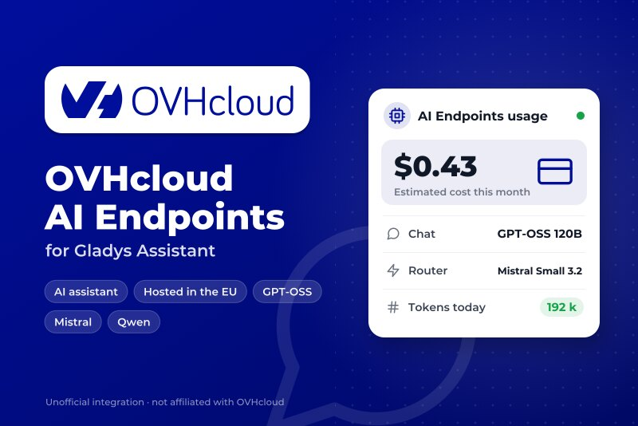
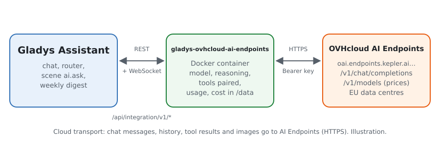
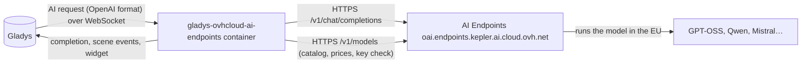
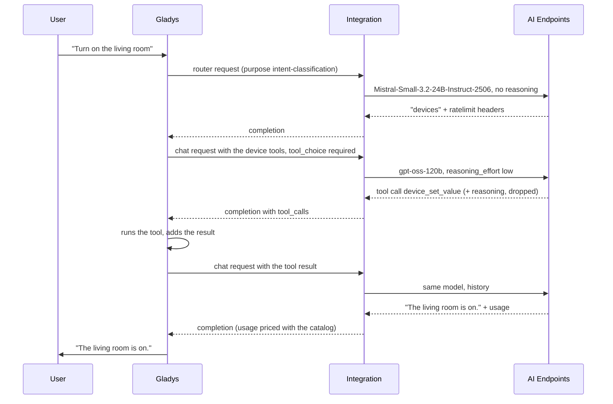
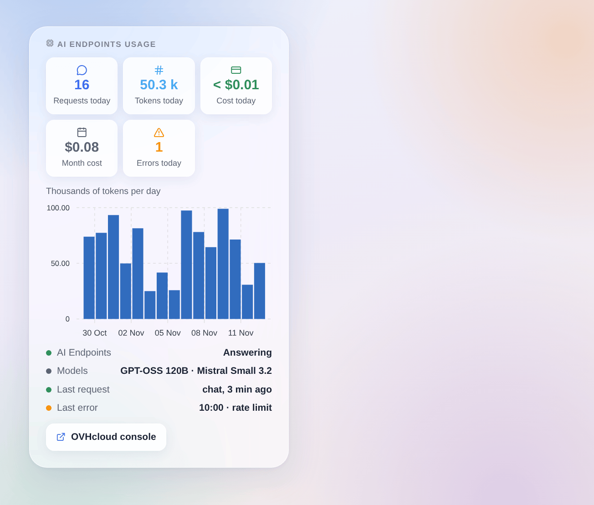

# Gladys OVHcloud AI Endpoints

**English** · [Français](README.fr.md) · [Deutsch](README.de.md) · [Español](README.es.md)

[](LICENSE)
[](https://github.com/William-De71/gladys-ovhcloud-ai-endpoints/releases)
[](https://github.com/William-De71/gladys-ovhcloud-ai-endpoints/actions/workflows/release.yml)
[](https://gladysassistant.com)



[Gladys Assistant](https://gladysassistant.com) external integration that runs the assistant of Gladys on **OVHcloud AI Endpoints**: open models (OpenAI GPT-OSS, Qwen, Mistral…) served from the data centres of OVHcloud in the European Union, billed per token to your Public Cloud project. Once selected in Settings → Artificial Intelligence, the model you chose answers the chat, controls your devices, creates scenes, answers the "ask the AI" scene action and writes the weekly digest — with or without a Gladys Plus account.

User documentation: [English](docs/en.md) · [Français](docs/fr.md) · [Deutsch](docs/de.md) · [Español](docs/es.md).

Not affiliated with OVHcloud. **Not tested with a real key yet**: the catalog, a tool call of GPT-OSS 120B and Mistral Small 3.2, the reasoning parameter and the error answers (403, 429) were captured from the real API on 25 November 2026; the tests run against a fake API built from them. Feedback welcome.

## Features

- **AI provider** (`type: "ai"`, Gladys 5.3+): every AI request of Gladys goes to AI Endpoints — the chat with its tool calls, the intent router, the scene "ask the AI" action, the weekly digest.
- **Two models**: a chat model (GPT-OSS 120B by default) and a router model (Mistral Small 3.2, which does not reason), among GPT-OSS 120B and 20B, Qwen 3.5 397B (reads the chat images), Mistral Small 3.2, Qwen 3.6 35B or any other model id of the catalog.
- **Reasoning level** of the chat model (off, low, medium, high), adapted to what each model accepts.
- **Estimated cost**: each answer is priced with the catalog prices (per token, cached tokens apart), per day and per month.
- **Scene triggers**: the assistant fails (key refused, project without payment method, rate limit, request too large, model unavailable, API unreachable) and answers again — once per failure.
- **Dashboard widget**: requests, tokens and estimated cost of the day, estimated cost of the month, tokens per day over 30 days, last answer and last error.
- **Test the connection** button; the configuration screen shows whether AI Endpoints accepts the key and whether both models are language models of the catalog, without spending anything.
- English, French, German and Spanish.

## How it works





The whole agentic loop (prompts, tools, history, image resizing) stays in Gladys; the integration picks the model and prepares each request and its answer:



What the integration handles: tool calls and results always paired (the ids Gladys writes for calls without one, such as `unknown`, get stable ones; a lone call gets a placeholder result), the reasoning effort closest to what each model accepts (GPT-OSS cannot turn it off, Mistral Small never reasons, a model that refuses the parameter no longer gets it), the reasoning that AI Endpoints returns in `message.reasoning` kept out of the history, and the bounds Gladys puts on a completion. A 429 or a 5xx is retried while the time the core waits allows it (18 s for the router, 110 s for the chat); a long wait or a request too large fails at once with its reason.

### Transport

`transports: ["cloud"]`: everything goes to `oai.endpoints.kepler.ai.cloud.ovh.net` over HTTPS. **AI Endpoints sees every chat message, the history, the tool definitions and results (the state of the devices the assistant reads) and the chat images**, and the answers drive your devices and scenes. OVHcloud says the service runs in the European Union, keeps no request and trains no model on them. Gladys never falls back to Gladys Plus when AI Endpoints fails: the chat says what is wrong. `/data` only keeps the usage counters of the widget.

## Models

| Choice            | Model id                              | Use                                                    | Reasoning   |
| ----------------- | ------------------------------------- | ------------------------------------------------------ | ----------- |
| GPT-OSS 120B      | `gpt-oss-120b`                        | Chat (default): capable, cheap ($0.09 / $0.47 per M)   | low to high |
| Qwen 3.5 397B     | `Qwen3.5-397B-A17B`                   | Chat that reads images, the largest ($0.71 / $4.25)    | off to high |
| Mistral Small 3.2 | `Mistral-Small-3.2-24B-Instruct-2506` | Router (default) or fast chat ($0.10 / $0.31)          | none        |
| Qwen 3.6 35B      | `qwen3.6-35b-a3b`                     | Light chat or router ($0.20 / $1.33)                   | off to high |
| GPT-OSS 20B       | `gpt-oss-20b`                         | Light chat or router ($0.05 / $0.18)                   | low to high |
| Other model       | your id                               | Any language model of the catalog that calls functions | as asked    |

Prices per million input / output tokens, from the catalog on 25 November 2026; the widget reads them again every 12 hours. AI Endpoints has no "latest" aliases: it retires models with three months of notice; "Other model" takes a successor. The status says when a chosen model is not in the catalog, or is not a language model.

## Scenes and widget



- **Trigger "AI Endpoints: the assistant fails"**: variables `kind` (`auth`, `project`, `rate_limit`, `too_large`, `model`, `unreachable`, `timeout`, `server`), `message`, `use`, `model`; filter by kind. A refused request (HTTP 400, a model that cannot read an image) is about that request only and starts nothing.
- **Trigger "AI Endpoints: the assistant answers again"**: variable `down_minutes`.
- **Widget "AI Endpoints usage"**: counted by the integration from the `usage` of each answer and the catalog prices, in US dollars (the currency of the catalog); requests made outside Gladys with the same project are not in it, and the bill of the project stays the reference.
- No scene action of its own: the "ask the AI" action of Gladys already asks the model chosen here, and AI Endpoints has no built-in web search.

Examples:

- _When the assistant fails_ (kind `auth`) → send a Telegram message to the administrator: "the AI Endpoints key was refused, create a new one".
- _When the assistant answers again_ → send "the assistant is back after `{{down_minutes}}` minutes".
- _When the assistant fails_ (kind `project`) → send an e-mail: "add a payment method to the Public Cloud project".

## Requirements

- Gladys Assistant **5.3.0** or later (AI providers); older instances cannot install the integration.
- An OVHcloud **Public Cloud** project with a payment method, and an API key created in it (Control Panel → Public Cloud → AI & Machine Learning → AI Endpoints → API keys).

### Price and limits

- **Per token**, per model (see Models). A chat turn makes at least two requests (router, then chat), more when tools are called. The **Metrics** tab of AI Endpoints in the Control Panel shows the calls and tokens per model.
- **400 requests a minute**, per project and per model; a 429 is retried within the time the core allows.
- **Without a key**: the documentation says 2 requests a minute, but on 25 November 2026 the API answered with a limit of one request a year per model (`x-ratelimit-limit-year: 1`): the integration never calls without a key.
- A project in **Discovery mode** (no payment method) is refused; the status says so.

## Installation

- **From the store**: Integrations → OVHcloud AI Endpoints → Install.
- **From the repository URL**: Integrations → external integration → `https://github.com/William-De71/gladys-ovhcloud-ai-endpoints`.
- **Developer mode**: run `npm start` with the variables given by Gladys (see Development).

## Configuration

| Field or button       | Default           | Meaning                                                                        |
| --------------------- | ----------------- | ------------------------------------------------------------------------------ |
| AI Endpoints API key  | —                 | Required, a secret: never shown again, never logged                            |
| Chat model            | GPT-OSS 120B      | Chat, scene creation, weekly digest                                            |
| Router model          | Mistral Small 3.2 | Sorts every message before the answer, within 20 s                             |
| Other model id        | —                 | Used when a model is set to "Other model" (case matters)                       |
| Reasoning             | low               | Of the chat model; the router gets the lowest level its model accepts          |
| Maximum answer length | 8192 tokens       | Reasoning included; a ceiling, only the tokens written are billed              |
| Test the connection   | —                 | One short answer from each model, with its time and the requests left (minute) |

## Usage

1. In Gladys (Integrations → OVHcloud AI Endpoints → Configuration): paste the API key, choose the models; press **Test the connection**.
2. Settings → **Artificial Intelligence**: choose **OVHcloud AI Endpoints** as the provider.
3. Talk to Gladys in the chat; add the widget to a dashboard; use the triggers in your scenes.

## Development

```bash
npm install
npm test                       # node --test, a fake AI Endpoints API on 127.0.0.1, never the network
npm run lint                   # ESLint
npm run format:check           # Prettier
npx github:GladysAssistant/integration-store . --skip-image-check
scripts/build-cover.sh         # cover.jpg from docs/assets/cover.svg
docs/illustrations/render.sh   # docs/assets/widgets.<lang>.png
```

Locally, the SDK reads `GLADYS_HOST_API_URL`, `GLADYS_INTEGRATION_TOKEN` and `GLADYS_INTEGRATION_SELECTOR` (given by Gladys in developer mode), and the integration reads `TZ`. `DEBUG=gladys-integration-sdk` shows the SDK logs.

The tests cover the HTTP client (errors, rate limit headers, retries, deadlines), the catalog and its prices, the conversion both ways (`validateAiCompletion` of the SDK, pairing), the chat handler (models per purpose, reasoning, refused parameter, cost), the triggers, the usage counters, the widget (`validateWidgetContent`), the manifest, the four languages, the release script, and the whole integration against the fake Gladys of the SDK. `test/structure.test.js` freezes every key users store.

## Release process


Every merge on `main` runs the CI, then computes the version from the [Conventional Commits](https://www.conventionalcommits.org/) since the last tag: `feat` → minor, `fix` / `perf` → patch, `!` or `BREAKING CHANGE` → major (a minor below 1.0.0); `docs`, `chore`, `ci`, `test`, `style`, `refactor`, `build` alone publish nothing. The changelog section is generated, the tag pushed, the multi-architecture image built, then `main` receives the release commit, the GitHub Release is created and a last job checks the public image, the store validator and the topic.

- The pull request title becomes the squash commit, then the changelog line: write it in English, for the user (`pr-title.yml` checks it). Never edit `CHANGELOG.md` by hand.
- 1.0.0 is a decision: Actions → Release → Run workflow with `release-as: 1.0.0`. `dry-run` shows the version and the notes without publishing.
- **Protected branch**: rulesets require a pull request on `main` and lock the `v*` tags; only the maintainer and deploy keys get through. The release pushes with the deploy key of the `release` environment (secret `RELEASE_DEPLOY_KEY`, `main` only): a run from another branch never gets it. `build.yml` and `github-release.yml` do not start on a tag: the release calls them, or run them by hand (Actions → Run workflow, with `version` for the image) to finish a release.
- After the first release, make the `ghcr.io` package public (Package settings → Change visibility), or Gladys cannot pull it.

## Troubleshooting

See [docs/en.md](docs/en.md#troubleshooting). Report issues with the versions of Gladys and of the integration, the models chosen and the message of **Test the connection**. Never paste your API key.

## Contributing

Issues and pull requests are welcome, especially from people with an AI Endpoints key: a failing request (without the key) helps a lot. Run `npm run format:check && npm run lint && npm test` before opening a pull request, and keep every stored key unchanged (see [CLAUDE.md](CLAUDE.md)).

## Security

See [SECURITY.md](SECURITY.md): report vulnerabilities privately. The API key is a `secret` field: never logged, never written to `/data`, sent only to `oai.endpoints.kepler.ai.cloud.ovh.net` over HTTPS.

## Screenshots to come

The images above are illustrations, not screenshots. Real screenshots will go in `docs/assets/screenshots/` (PNG, 1280 × 800): `configuration.png` (the configuration with its status), `ai-settings.png` (OVHcloud AI Endpoints chosen in Settings → Artificial Intelligence), `chat.png` (a chat that switches a device on), `widget.png` (the usage widget on a dashboard).

## License

[Apache License 2.0](LICENSE) — see also [NOTICE](NOTICE). OVHcloud is a trademark of OVH SAS; model names belong to their owners. This project is not affiliated with, endorsed or sponsored by OVHcloud. Thanks to the Gladys documentation and SDK, and to the OVHcloud documentation.
