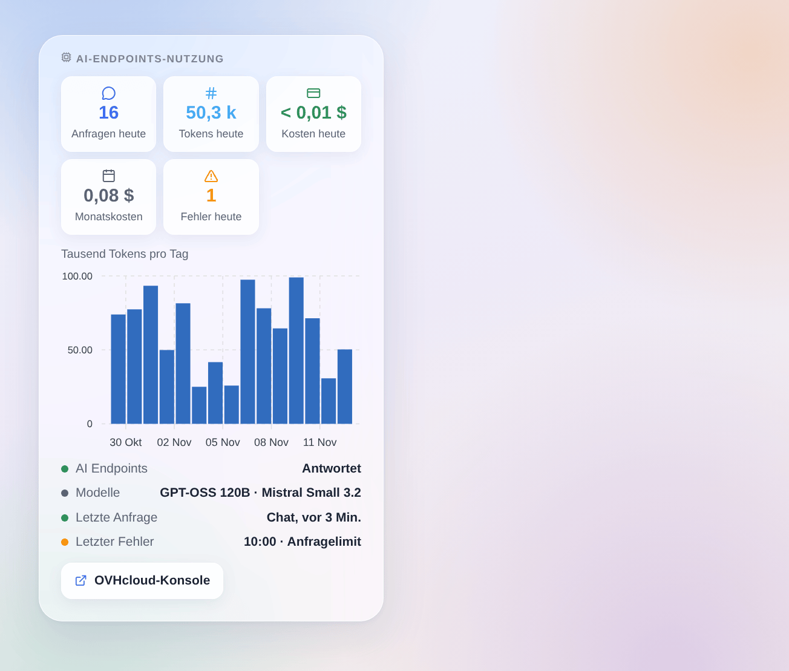

# OVHcloud AI Endpoints

## Überblick

Diese Integration lässt den Gladys-Assistenten auf **OVHcloud AI Endpoints** laufen, dem KI-Dienst von OVHcloud: offene Modelle (OpenAI GPT-OSS, Qwen, Mistral …) aus seinen Rechenzentren in der Europäischen Union, pro Token über ein Public-Cloud-Projekt abgerechnet. Sobald sie unter **Einstellungen → Künstliche Intelligenz** gewählt ist, gehen alle KI-Anfragen von Gladys an AI Endpoints: der Chat und die Geräte, die er steuert, die Szenen, die er erstellt, die Szenenaktion „KI fragen“ und der Wochenrückblick. Sie funktioniert mit oder ohne Gladys-Plus-Konto.

Dazu kommen zwei Szenenauslöser (der Assistent hat einen Fehler, der Assistent antwortet wieder) und ein Dashboard-Widget mit den Anfragen, den Tokens und den **geschätzten Kosten** des Tages und des Monats.

Nicht mit OVHcloud verbunden. Noch nicht mit einem echten Schlüssel getestet: Rückmeldungen sind willkommen.

## Voraussetzungen

- Gladys Assistant 5.3.0 oder neuer.
- Ein OVHcloud-**Public-Cloud**-Projekt mit einer **Zahlungsmethode**: Ein Projekt im Discovery-Modus wird abgelehnt.
- Ein API-Schlüssel: OVHcloud Control Panel → Public Cloud → dein Projekt → **AI & Machine Learning → AI Endpoints → API keys** → **Create an API key**. Er wird nur einmal angezeigt; ein Ablaufdatum ist optional.
- **Preis**: pro Token, je nach Modell verschieden (zum Beispiel GPT-OSS 120B: 0,09 $ pro Million Eingabe-Tokens und 0,47 $ pro Million Ausgabe-Tokens im Katalog vom November 2026). Eine Chat-Nachricht macht mindestens zwei Anfragen (Router, dann Chat). Die Metriken des Projekts (Reiter **Metrics** von AI Endpoints) und die Rechnung bleiben maßgeblich.
- **Limit**: 400 Anfragen pro Minute je Projekt und Modell. Ohne Schlüssel erlaubt AI Endpoints nur noch eine Anfrage pro Jahr und Modell (beobachtet im November 2026): Ein Schlüssel ist nötig.
- Was dein Zuhause verlässt: jede Chat-Nachricht, der Verlauf, die Werkzeuge, die Gladys anbietet, und ihre Ergebnisse (der Zustand der Geräte, die der Assistent liest) und die Chat-Bilder gehen per HTTPS an AI Endpoints. OVHcloud gibt an, keine Anfragen zu speichern und kein Modell damit zu trainieren. Die Antworten steuern deine Geräte und erstellen Szenen.

## Konfiguration

| Feld oder Schaltfläche         | Standard          | Rolle                                                                                              |
| ------------------------------ | ----------------- | -------------------------------------------------------------------------------------------------- |
| AI-Endpoints-API-Schlüssel     | —                 | Pflichtfeld. Nie wieder angezeigt, nie protokolliert                                               |
| Chat-Modell                    | GPT-OSS 120B      | Beantwortet den Chat, erstellt die Szenen, schreibt den Wochenrückblick                            |
| Router-Modell                  | Mistral Small 3.2 | Sortiert jede Nachricht vor der Antwort und muss innerhalb von 20 Sekunden antworten               |
| ID des anderen Modells         | —                 | Nur für „Anderes Modell“: die genaue ID aus dem Katalog (Werkzeuge!)                               |
| Nachdenken des Chat-Modells    | Niedrig           | Mehr Nachdenken, bessere Szenen, langsamere Antworten mit mehr Verbrauch                           |
| Maximale Antwortlänge (Tokens) | 8192              | Eine Obergrenze, Nachdenken inbegriffen: Nur die geschriebenen Tokens werden berechnet             |
| Verbindung testen              | —                 | Eine kurze Antwort jedes Modells mit seiner Zeit und den Anfragen, die in dieser Minute übrig sind |

Der Status der Konfigurationsseite zeigt, ob AI Endpoints den Schlüssel akzeptiert und ob beide Modelle Sprachmodelle seines Katalogs sind, ohne etwas zu verbrauchen.

## Verwendung

1. Integrationen → **OVHcloud AI Endpoints** → Konfiguration: Füge den API-Schlüssel ein, behalte die Standardmodelle und drücke **Verbindung testen**.
2. Einstellungen → **Künstliche Intelligenz**: Wähle **OVHcloud AI Endpoints**.
3. Sprich im Chat mit Gladys: „Schalte das Wohnzimmer ein“, „Wie warm ist es im Schlafzimmer?“, „Erstelle eine Szene, die bei Sonnenuntergang die Rollläden schließt“.

### Die Modelle wählen

- **GPT-OSS 120B** (Standard im Chat): das größte offene Modell von OpenAI, zuverlässig mit Werkzeugen und günstig. Geprüft: Es ruft Werkzeuge mit niedrigem Nachdenken auf.
- **Qwen 3.5 397B**: das größte Modell des Katalogs und das einzige der Liste, das **die Bilder** des Chats liest; deutlich teurer.
- **Mistral Small 3.2** (Standard im Router): denkt nicht nach, antwortet schnell und ruft Werkzeuge auf; auch ein gutes Chat-Modell für ein kleines Zuhause.
- **Qwen 3.6 35B** und **GPT-OSS 20B**: leichtere Modelle, für den Chat oder den Router.
- **Anderes Modell**: jede ID aus dem [Katalog von AI Endpoints](https://www.ovhcloud.com/de/public-cloud/ai-endpoints/catalog/), die Function Calling beherrscht, mit Groß- und Kleinschreibung, etwa `Meta-Llama-3_3-70B-Instruct`. Ein Sprach-, Bild- oder Embedding-Modell wird sofort abgelehnt.

GPT-OSS denkt immer ein wenig nach: Die Stufe „Aus“ ergibt die niedrige Stufe; Mistral Small 3.2 denkt nie nach. Lehnt ein anderes Modell den Parameter für das Nachdenken ab, sendet die Integration ihn von da an nicht mehr.

### Dashboard-Widget

Das Widget **AI-Endpoints-Nutzung** zeigt die Anfragen, Tokens, geschätzten Kosten und Fehler des Tages, die geschätzten Kosten des Monats, die Tokens pro Tag über 30 Tage, ob AI Endpoints antwortet, die Modelle, die letzte Anfrage und den letzten Fehler sowie einen Link zum Control Panel. Die Kosten werden von der Integration anhand der Katalogpreise **geschätzt** (in US-Dollar, der Währung des Katalogs): Maßgeblich bleibt die Rechnung des Projekts, und Anfragen außerhalb von Gladys mit demselben Projekt sind nicht enthalten.

### Szenen

- **Auslöser „AI Endpoints: Der Assistent hat einen Fehler“**: einmal pro Ausfall (Schlüssel abgelehnt, Projekt ohne Zahlungsmethode, Anfragelimit, Anfrage zu groß, Modell nicht verfügbar, API nicht erreichbar, zu langsam, AI-Endpoints-Fehler), mit der Art, der Meldung, der Anfrage und dem Modell.
- **Auslöser „AI Endpoints: Der Assistent antwortet wieder“**: die erste Antwort nach einem Ausfall, mit den Minuten des Ausfalls.

Keine eigene Szenenaktion: Die Aktion „KI fragen“ von Gladys fragt bereits das hier gewählte Modell. Beispiele: Wenn der Assistent einen Fehler hat, weil der Schlüssel abgelehnt wird, eine Telegram-Nachricht an den Administrator senden; wenn er wieder antwortet, ihm sagen, wie viele Minuten der Ausfall gedauert hat.

## Fehlerbehebung

- **„AI Endpoints hat den API-Schlüssel abgelehnt“**: Der Schlüssel ist falsch, abgelaufen oder widerrufen; erstelle einen neuen im Control Panel.
- **„Das Public-Cloud-Projekt dieses Schlüssels ist im Discovery-Modus“**: Füge dem Projekt eine Zahlungsmethode hinzu und erstelle dann einen neuen Schlüssel.
- **„AI-Endpoints-Limit erreicht“**: 400 Anfragen pro Minute und Modell; warte eine Minute.
- **„… ist nicht im Katalog von AI Endpoints“**: Die ID ist falsch (Groß- und Kleinschreibung zählt) oder das Modell wurde eingestellt; OVHcloud kündigt das drei Monate vorher an.
- **„cannot read images“**: Wähle Qwen 3.5 397B als Chat-Modell.
- **„The answer was cut at max_tokens“**: Erhöhe die maximale Antwortlänge.
- Protokolle: Einstellungen → System, die Protokolle der Integration. Teile niemals deinen API-Schlüssel.
