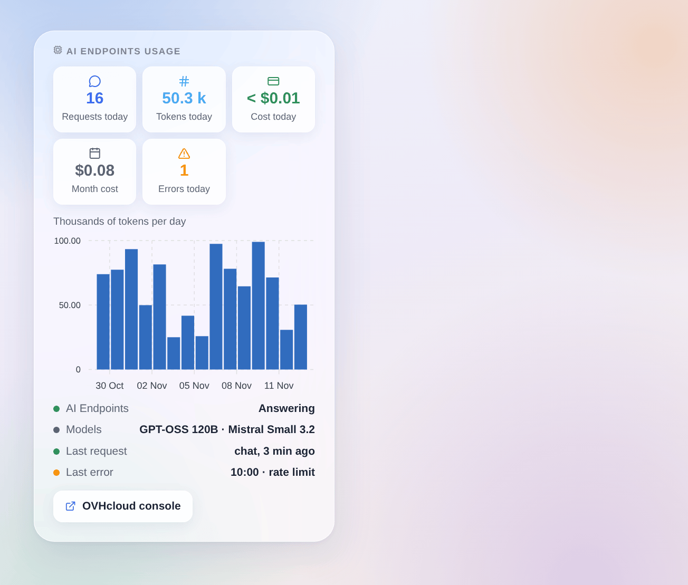

# OVHcloud AI Endpoints

## Overview

This integration runs the Gladys assistant on **OVHcloud AI Endpoints**, the AI service of OVHcloud: open models (OpenAI GPT-OSS, Qwen, Mistral…) served from its data centres in the European Union, billed per token to a Public Cloud project. Once selected in **Settings → Artificial Intelligence**, every AI request of Gladys goes to AI Endpoints: the chat and the devices it controls, the scenes it creates, the "ask the AI" scene action and the weekly digest. It works with or without a Gladys Plus account.

It also adds two scene triggers (the assistant fails, the assistant answers again) and a dashboard widget with the requests, the tokens and an **estimated cost** for the day and the month.

Not affiliated with OVHcloud. Not yet tested with a real key: feedback is welcome.

## Requirements

- Gladys Assistant 5.3.0 or newer.
- An OVHcloud **Public Cloud** project with a **payment method**: a project in Discovery mode is refused.
- An API key: OVHcloud Control Panel → Public Cloud → your project → **AI & Machine Learning → AI Endpoints → API keys** → **Create an API key**. It is shown only once; an expiry date is optional.
- **Price**: per token, different for each model (for example GPT-OSS 120B: $0.09 per million input tokens and $0.47 per million output tokens in the November 2026 catalog). A chat message makes at least two requests (router, then chat). The metrics of the project (the **Metrics** tab of AI Endpoints) and the bill stay the reference.
- **Limit**: 400 requests a minute, per project and per model. Without a key, AI Endpoints now allows a single request a year per model (seen in November 2026): the key is required.
- What leaves your home: every chat message, the history, the tools Gladys offers and their results (the state of the devices the assistant reads) and the chat images go to AI Endpoints over HTTPS. OVHcloud says it keeps no request and trains no model on them. The answers control your devices and create scenes.

## Configuration

| Field or button                | Default           | Role                                                                           |
| ------------------------------ | ----------------- | ------------------------------------------------------------------------------ |
| AI Endpoints API key           | —                 | Required. Never shown again, never logged                                      |
| Chat model                     | GPT-OSS 120B      | Answers the chat, creates the scenes, writes the weekly digest                 |
| Router model                   | Mistral Small 3.2 | Sorts every message before the answer and must reply within 20 seconds         |
| Other model id                 | —                 | Only for "Other model": the exact id of the catalog (tools!)                   |
| Reasoning of the chat model    | Low               | More reasoning, better scenes, slower answers that use more                    |
| Maximum answer length (tokens) | 8192              | A ceiling, reasoning included: only the tokens written are billed              |
| Test the connection            | —                 | A short answer from each model with its time and the requests left this minute |

The status of the Configuration screen says whether AI Endpoints accepts the key and whether both models are language models of its catalog, without spending anything.

## Usage

1. Integrations → **OVHcloud AI Endpoints** → Configuration: paste the API key, keep the default models, press **Test the connection**.
2. Settings → **Artificial Intelligence**: choose **OVHcloud AI Endpoints**.
3. Talk to Gladys in the chat: "turn on the living room", "what is the temperature in the bedroom?", "create a scene that closes the shutters at sunset".

### Choosing the models

- **GPT-OSS 120B** (chat default): the largest open model of OpenAI, reliable with tools and cheap. Checked: it calls tools with low reasoning.
- **Qwen 3.5 397B**: the largest model of the catalog, and the only one of the list that **reads the images** of the chat; clearly more expensive.
- **Mistral Small 3.2** (router default): does not reason, answers fast and calls tools; also a good chat model for a small home.
- **Qwen 3.6 35B** and **GPT-OSS 20B**: lighter models, for the chat or the router.
- **Other model**: any id of the [AI Endpoints catalog](https://www.ovhcloud.com/en/public-cloud/ai-endpoints/catalog/) that supports function calling, case included, such as `Meta-Llama-3_3-70B-Instruct`. A speech, image or embedding model is refused at once.

GPT-OSS always reasons a little: the "Off" level gives it the low level; Mistral Small 3.2 never reasons. If another model refuses the reasoning parameter, the integration sends it without, from then on.

### Dashboard widget

The **AI Endpoints usage** widget shows the requests, tokens, estimated cost and errors of the day, the estimated cost of the month, the tokens per day over 30 days, whether AI Endpoints answers, the models, the last request and the last error, and a link to the Control Panel. The cost is **estimated** by the integration from the catalog prices (in US dollars, the currency of the catalog): the bill of the project stays the reference, and requests made outside Gladys with the same project are not in it.

### Scenes

- **Trigger "AI Endpoints: the assistant fails"**: once per failure (key refused, project without payment method, rate limit, request too large, model unavailable, API unreachable, too slow, AI Endpoints error), with the kind, the message, the request and the model.
- **Trigger "AI Endpoints: the assistant answers again"**: the first answer after a failure, with the minutes of failure.

No scene action of its own: the "ask the AI" action of Gladys already asks the model chosen here. Examples: when the assistant fails because the key is refused, send a Telegram message to the administrator; when it answers again, tell them how many minutes the failure lasted.

## Troubleshooting

- **"AI Endpoints refused the API key"**: the key is wrong, expired or revoked; create a new one in the Control Panel.
- **"The Public Cloud project of this key is in Discovery mode"**: add a payment method to the project, then create a new key.
- **"AI Endpoints rate limit reached"**: 400 requests a minute per model; wait a minute.
- **"… is not in the AI Endpoints catalog"**: the id is wrong (case included) or the model was retired; OVHcloud gives three months of notice.
- **"cannot read images"**: choose Qwen 3.5 397B as the chat model.
- **"The answer was cut at max_tokens"**: raise the maximum answer length.
- Logs: Settings → System, the logs of the integration. Never share your API key.
