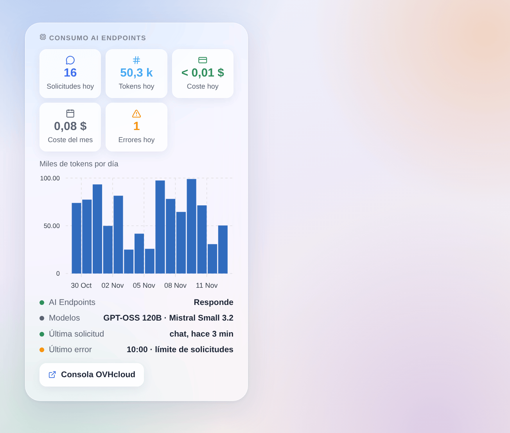

# OVHcloud AI Endpoints

## Presentación

Esta integración hace funcionar el asistente de Gladys en **OVHcloud AI Endpoints**, el servicio de IA de OVHcloud: modelos abiertos (OpenAI GPT-OSS, Qwen, Mistral…) servidos desde sus centros de datos de la Unión Europea, facturados por token a un proyecto Public Cloud. Una vez elegida en **Ajustes → Inteligencia artificial**, todas las solicitudes de IA de Gladys van a AI Endpoints: el chat y los dispositivos que controla, las escenas que crea, la acción de escena «preguntar a la IA» y el resumen semanal. Funciona con o sin cuenta Gladys Plus.

También añade dos disparadores de escena (el asistente falla, el asistente vuelve a responder) y un widget del panel con las solicitudes, los tokens y un **coste estimado** del día y del mes.

Sin relación con OVHcloud. Todavía no probada con una clave real: los comentarios son bienvenidos.

## Requisitos

- Gladys Assistant 5.3.0 o más reciente.
- Un proyecto **Public Cloud** de OVHcloud con un **método de pago**: un proyecto en modo Discovery se rechaza.
- Una clave de API: área de cliente de OVHcloud → Public Cloud → su proyecto → **AI & Machine Learning → AI Endpoints → API keys** → **Create an API key**. Solo se muestra una vez; la fecha de caducidad es opcional.
- **Precio**: por token, distinto para cada modelo (por ejemplo GPT-OSS 120B: 0,09 $ por millón de tokens de entrada y 0,47 $ por millón de salida en el catálogo de noviembre de 2026). Un mensaje del chat hace al menos dos solicitudes (enrutador y luego chat). Las métricas del proyecto (pestaña **Metrics** de AI Endpoints) y la factura siguen siendo la referencia.
- **Límite**: 400 solicitudes por minuto, por proyecto y por modelo. Sin clave, AI Endpoints solo acepta ya una solicitud al año por modelo (comprobado en noviembre de 2026): la clave es imprescindible.
- Lo que sale de su casa: cada mensaje del chat, el historial, las herramientas que ofrece Gladys y sus resultados (el estado de los dispositivos que lee el asistente) y las imágenes del chat van a AI Endpoints por HTTPS. OVHcloud afirma no conservar ninguna solicitud ni entrenar ningún modelo con ellas. Las respuestas controlan sus dispositivos y crean escenas.

## Configuración

| Campo o botón                             | Por defecto       | Función                                                                                    |
| ----------------------------------------- | ----------------- | ------------------------------------------------------------------------------------------ |
| Clave de API de AI Endpoints              | —                 | Obligatoria. Nunca se vuelve a mostrar ni se registra                                      |
| Modelo del chat                           | GPT-OSS 120B      | Responde al chat, crea las escenas, redacta el resumen semanal                             |
| Modelo del enrutador                      | Mistral Small 3.2 | Clasifica cada mensaje antes de la respuesta y debe contestar en menos de 20 segundos      |
| Identificador del otro modelo             | —                 | Solo para «Otro modelo»: el identificador exacto del catálogo (¡herramientas!)             |
| Razonamiento del modelo del chat          | Bajo              | Más razonamiento, mejores escenas, respuestas más lentas que consumen más                  |
| Longitud máxima de una respuesta (tokens) | 8192              | Un límite, razonamiento incluido: solo se facturan los tokens escritos                     |
| Probar la conexión                        | —                 | Una respuesta corta de cada modelo con su tiempo y las solicitudes que quedan en el minuto |

El estado de la pantalla de configuración indica si AI Endpoints acepta la clave y si los dos modelos son modelos de lenguaje de su catálogo, sin gastar nada.

## Uso

1. Integraciones → **OVHcloud AI Endpoints** → Configuración: pegue la clave de API, mantenga los modelos por defecto y pulse **Probar la conexión**.
2. Ajustes → **Inteligencia artificial**: elija **OVHcloud AI Endpoints**.
3. Hable con Gladys en el chat: «enciende el salón», «¿qué temperatura hace en el dormitorio?», «crea una escena que cierre las persianas al atardecer».

### Elegir los modelos

- **GPT-OSS 120B** (por defecto en el chat): el mayor modelo abierto de OpenAI, fiable con las herramientas y económico. Comprobado: llama a las herramientas con razonamiento bajo.
- **Qwen 3.5 397B**: el mayor modelo del catálogo y el único de la lista que **lee las imágenes** del chat; claramente más caro.
- **Mistral Small 3.2** (por defecto en el enrutador): no razona, responde rápido y llama a las herramientas; también es un buen modelo de chat para una casa pequeña.
- **Qwen 3.6 35B** y **GPT-OSS 20B**: modelos más ligeros, para el chat o el enrutador.
- **Otro modelo**: cualquier identificador del [catálogo de AI Endpoints](https://www.ovhcloud.com/es-es/public-cloud/ai-endpoints/catalog/) que admita llamadas a funciones, respetando mayúsculas y minúsculas, por ejemplo `Meta-Llama-3_3-70B-Instruct`. Un modelo de voz, de imagen o de embeddings se rechaza al momento.

GPT-OSS siempre razona un poco: el nivel «Desactivado» le da el nivel bajo; Mistral Small 3.2 nunca razona. Si otro modelo rechaza el parámetro de razonamiento, la integración lo envía sin él a partir de entonces.

### Widget del panel

El widget **Consumo AI Endpoints** muestra las solicitudes, los tokens, el coste estimado y los errores del día, el coste estimado del mes, los tokens por día en 30 días, si AI Endpoints responde, los modelos, la última solicitud y el último error, y un enlace al área de cliente. La integración **estima** el coste con los precios del catálogo (en dólares estadounidenses, la moneda del catálogo): la factura del proyecto sigue siendo la referencia, y no incluye las solicitudes hechas fuera de Gladys con el mismo proyecto.

### Escenas

- **Disparador «AI Endpoints: el asistente falla»**: una vez por fallo (clave rechazada, proyecto sin método de pago, límite de solicitudes, solicitud demasiado grande, modelo no disponible, API inaccesible, demasiado lento, error de AI Endpoints), con el tipo, el mensaje, la solicitud y el modelo.
- **Disparador «AI Endpoints: el asistente vuelve a responder»**: la primera respuesta tras un fallo, con los minutos de fallo.

Sin acción de escena propia: la acción «preguntar a la IA» de Gladys ya consulta el modelo elegido aquí. Ejemplos: cuando el asistente falla porque la clave se rechaza, enviar un mensaje de Telegram al administrador; cuando vuelve a responder, decirle cuántos minutos duró el fallo.

## Solución de problemas

- **«AI Endpoints ha rechazado la clave de API»**: la clave es errónea, ha caducado o se ha revocado; cree una nueva en el área de cliente.
- **«El proyecto Public Cloud de esta clave está en modo Discovery»**: añada un método de pago al proyecto y luego cree una clave nueva.
- **«Se ha alcanzado el límite de AI Endpoints»**: 400 solicitudes por minuto y modelo; espere un minuto.
- **«… no está en el catálogo de AI Endpoints»**: el identificador es erróneo (con mayúsculas y minúsculas) o el modelo se ha retirado; OVHcloud avisa con tres meses de antelación.
- **«cannot read images»**: elija Qwen 3.5 397B como modelo del chat.
- **«The answer was cut at max_tokens»**: aumente la longitud máxima de una respuesta.
- Registros: Ajustes → Sistema, los registros de la integración. No comparta nunca su clave de API.
