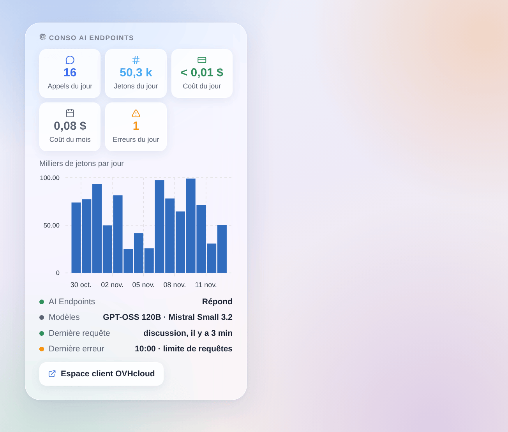

# OVHcloud AI Endpoints

## Présentation

Cette intégration fait tourner l’assistant de Gladys sur **OVHcloud AI Endpoints**, le service d’IA d’OVHcloud : des modèles ouverts (OpenAI GPT-OSS, Qwen, Mistral…) servis depuis ses centres de données de l’Union européenne, facturés au jeton sur un projet Public Cloud. Une fois choisie dans **Paramètres → Intelligence artificielle**, toutes les requêtes d’IA de Gladys partent vers AI Endpoints : le chat et les appareils qu’il pilote, les scènes qu’il crée, l’action de scène « demander à l’IA » et le résumé hebdomadaire. Elle fonctionne avec ou sans compte Gladys Plus.

Elle ajoute aussi deux déclencheurs de scène (l’assistant est en erreur, l’assistant répond de nouveau) et un widget de tableau de bord avec les requêtes, les jetons et un **coût estimé** du jour et du mois.

Sans lien avec OVHcloud. Pas encore testée avec une vraie clé : les retours sont bienvenus.

## Prérequis

- Gladys Assistant 5.3.0 ou plus récent.
- Un projet **Public Cloud** OVHcloud avec un **moyen de paiement** : un projet en mode Découverte est refusé.
- Une clé d’API : espace client OVHcloud → Public Cloud → votre projet → **AI & Machine Learning → AI Endpoints → API keys** → **Create an API key**. Elle n’est affichée qu’une fois ; une date d’expiration est facultative.
- **Prix** : au jeton, différent pour chaque modèle (par exemple GPT-OSS 120B : 0,09 $ par million de jetons en entrée et 0,47 $ en sortie au catalogue de novembre 2026). Un message du chat fait au moins deux requêtes (routeur, puis chat). Les métriques du projet (onglet **Metrics** d’AI Endpoints) et la facture restent la référence.
- **Limite** : 400 requêtes par minute, par projet et par modèle. Sans clé, AI Endpoints n’accepte plus qu’une requête par an et par modèle (constaté en novembre 2026) : la clé est indispensable.
- Ce qui sort de chez vous : chaque message du chat, l’historique, les outils que Gladys propose et leurs résultats (l’état des appareils que l’assistant consulte) et les images du chat partent vers AI Endpoints en HTTPS. OVHcloud indique ne conserver aucune requête et n’entraîner aucun modèle avec. Les réponses pilotent vos appareils et créent des scènes.

## Configuration

| Champ ou bouton                          | Défaut            | Rôle                                                                                        |
| ---------------------------------------- | ----------------- | ------------------------------------------------------------------------------------------- |
| Clé d’API AI Endpoints                   | —                 | Obligatoire. Plus jamais affichée, jamais journalisée                                       |
| Modèle du chat                           | GPT-OSS 120B      | Répond au chat, crée les scènes, rédige le résumé hebdomadaire                              |
| Modèle du routeur                        | Mistral Small 3.2 | Trie chaque message avant la réponse et doit répondre en moins de 20 secondes               |
| Identifiant de l’autre modèle            | —                 | Seulement pour « Autre modèle » : l’identifiant exact du catalogue (outils !)               |
| Réflexion du modèle du chat              | Faible            | Plus de réflexion, de meilleures scènes, des réponses plus lentes qui consomment plus       |
| Longueur maximale d’une réponse (jetons) | 8192              | Un plafond, réflexion comprise : seuls les jetons écrits sont facturés                      |
| Tester la connexion                      | —                 | Une réponse courte de chaque modèle avec son temps et les requêtes restantes pour la minute |

Le statut de l’écran de configuration indique si AI Endpoints accepte la clé et si les deux modèles sont des modèles de langage de son catalogue, sans rien dépenser.

## Utilisation

1. Intégrations → **OVHcloud AI Endpoints** → Configuration : collez la clé d’API, gardez les modèles par défaut, appuyez sur **Tester la connexion**.
2. Paramètres → **Intelligence artificielle** : choisissez **OVHcloud AI Endpoints**.
3. Parlez à Gladys dans le chat : « allume le salon », « quelle température dans la chambre ? », « crée une scène qui ferme les volets au coucher du soleil ».

### Choisir les modèles

- **GPT-OSS 120B** (défaut du chat) : le plus grand modèle ouvert d’OpenAI, fiable avec les outils et peu cher. Vérifié : il appelle les outils avec la réflexion faible.
- **Qwen 3.5 397B** : le plus gros modèle du catalogue, et le seul de la liste qui **lit les images** du chat ; nettement plus cher.
- **Mistral Small 3.2** (défaut du routeur) : ne réfléchit pas, répond vite et appelle les outils ; un bon modèle de chat aussi pour une petite maison.
- **Qwen 3.6 35B** et **GPT-OSS 20B** : des modèles plus légers, pour le chat ou le routeur.
- **Autre modèle** : tout identifiant du [catalogue d’AI Endpoints](https://www.ovhcloud.com/fr/public-cloud/ai-endpoints/catalog/) qui sait appeler des outils (function calling), en respectant les majuscules, par exemple `Meta-Llama-3_3-70B-Instruct`. Un modèle de voix, d’image ou de plongements est refusé tout de suite.

GPT-OSS réfléchit toujours un peu : le niveau « Désactivée » lui donne le niveau faible ; Mistral Small 3.2 ne réfléchit jamais. Si un autre modèle refuse le paramètre de réflexion, l’intégration l’envoie sans, à partir de là.

### Widget du tableau de bord

Le widget **Conso AI Endpoints** affiche les requêtes, les jetons, le coût estimé et les erreurs du jour, le coût estimé du mois, les jetons par jour sur 30 jours, si AI Endpoints répond, les modèles, la dernière requête et la dernière erreur, et un lien vers l’espace client. Le coût est **estimé** par l’intégration d’après les prix du catalogue (en dollars US, la monnaie du catalogue) : la facture du projet reste la référence, et les requêtes faites hors de Gladys avec le même projet n’y sont pas.

### Scènes

- **Déclencheur « AI Endpoints : l’assistant est en erreur »** : une fois par panne (clé refusée, projet sans moyen de paiement, limite de requêtes, requête trop grosse, modèle indisponible, API injoignable, trop lent, erreur d’AI Endpoints), avec le type, le message, la requête et le modèle.
- **Déclencheur « AI Endpoints : l’assistant répond de nouveau »** : la première réponse après une panne, avec les minutes de panne.

Pas d’action de scène propre : l’action « demander à l’IA » de Gladys interroge déjà le modèle choisi ici. Exemples : quand l’assistant est en erreur parce que la clé est refusée, envoyer un message Telegram à l’administrateur ; quand il répond de nouveau, lui dire combien de minutes la panne a duré.

## Dépannage

- **« AI Endpoints a refusé la clé d’API »** : la clé est fausse, expirée ou révoquée ; créez-en une nouvelle dans l’espace client.
- **« Le projet Public Cloud de cette clé est en mode Découverte »** : ajoutez un moyen de paiement au projet, puis créez une nouvelle clé.
- **« Limite d’AI Endpoints atteinte »** : 400 requêtes par minute et par modèle ; patientez une minute.
- **« … n’est pas dans le catalogue d’AI Endpoints »** : l’identifiant est faux (majuscules comprises) ou le modèle a été retiré ; OVHcloud prévient trois mois avant.
- **« cannot read images »** : choisissez Qwen 3.5 397B comme modèle du chat.
- **« The answer was cut at max_tokens »** : augmentez la longueur maximale d’une réponse.
- Journaux : Paramètres → Supervision, les journaux de l’intégration. Ne partagez jamais votre clé d’API.
